

  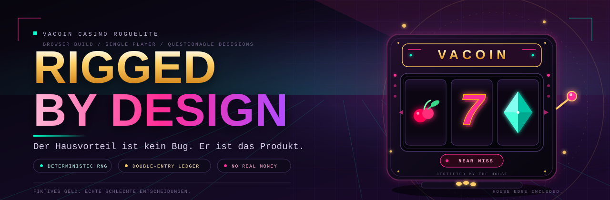

  
  
  
  

<h3 align="center"><em>„Der Hausvorteil ist kein Softwarefehler. Er ist die Geschäftsidee des Universums."</em></h3>

  Eine satirische Lebenssimulation über Hausvorteile, schmutzige Böden 
  und die erstaunliche Haltbarkeit eines vererbten Sofas.

---

  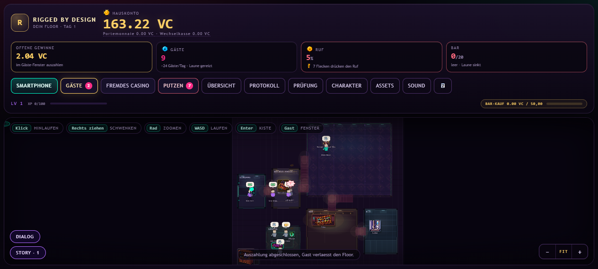

<em>Du startest mit einem Schlüsselbund, einem wackeligen Spielautomaten und keiner Ahnung. Der Rest ist das Leben.</em>

---

## Willkommen im Nachlass: Das Erbe deines Vaters

Dein alter Herr hat dir keine Schweizer Konten hinterlassen. Er hat dir einen schweren Messingschlüssel vermacht, eine abgewetzte Lederjacke, einen verstaubten Spielautomaten namens *„Lucky Strike"* und einen Leitz-Ordner voller zerknitterter Quittungen, auf denen auffällig oft das Wort **„Jackpot!"** und erschreckend selten das Wort **„Steuererklärung"** vorkommt.

Zwischen einem letzten Tankstellenbeleg und einer vergilbten Notiz, die *„Einfach verdoppeln!"* für eine solide Altersvorsorge hält, steht immerhin ein Ladenlokal: ein paar abgewetzte Kacheln, flackerndes Neonlicht und die beruhigende Gewissheit, dass die Miete nächsten Monat fällig wird. 

Du startest mit **150 VaCoins (VC)** virtuellem Startkapital. Die Bank nennt das *„akut insolvenzgefährdet"*. Wir nennen es das Tutorial deines neuen Lebens.

---

## Die Vision: Das Leben ist gezinkt

**Rigged by Design ist das Leben.** Der Titel ist ein Wortspiel, und er meint zuerst nicht die Spielbank an der Ecke: Man sucht sich nicht aus, in welche Verhältnisse man hineingeboren wird. Andere haben mit ihrem Dasein schon angefangen, bevor du die Bühne betreten hast – deine Eltern, dein Vermieter, der Kioskbesitzer und der Typ, der dir damals auf dem Schulhof das Pausenbrot abgezogen hat. Ihre Entscheidungen sind die Spielregeln, unter denen du antreten musst.

Das **Casino ist dein Startpunkt und deine Testbude**: Hier lernst du am eigenen Leib, wie Wahrscheinlichkeiten funktionieren, warum das Haus am Ende immer gewinnt – und was passiert, wenn du selbst versuchst, das Haus zu sein. 

Aber *Rigged by Design* ist kein steriler Casino-Manager, bei dem man auf Tabellen klickt, bis der Kontostand grün leuchtet. Es ist eine **echte Lebenssimulation**:
- **Du schaust spätabends eine Krimiserie im Röhrenfernseher:** Dein Intellekt steigt, deine Augenringe auch.
- **Die Bierwerbung im Werbeblock:** Steigert deinen Durst und deine Konsumbereitschaft, aber nicht deinen Kontostand.
- **Laune und Intellekt formen dein Charisma:** Charisma entscheidet, ob dir der Stammgast an der Bar ein Geheimnis verrät oder dir vor die Füße spuckt, weil du ihm gestern einen lauwarmen Drink serviert hast.
- **Hast du heute Geld im Portemonnaie?** Dann gibst du deinem Kumpel einen Döner aus – das Spiel verbucht das nicht als Zahlenspielerei, sondern als echte Beziehung.
- **Deine Schuhe haben Löcher:** Billige Treter drücken auf die Stimmung; die teuren Designer-Sneaker kosten ein halbes Monatsgehalt, bringen dir aber Respekt bei den Leuten auf der Straße ein.

Das Casino ist nur der erste Raum. Die Reise führt von der kleinen Absteige über eigene Immobilien, Bars, Nachtclubs und Arenen bis zum verwinkelten Unterhaltungsnetzwerk einer ganzen Stadt.

<em>Die vierte Wand ist vorhanden. Sie steht allerdings auf der Inventarliste unter „stark renovierungsbedürftig".</em>

---

## Was heute im Laden läuft

Keine leeren Ankündigungen – der aktuelle Spielstand ist eine voll funktionsfähige, lebendige Simulation.

### 1. Echte Handarbeit auf dem Floor
Du steuerst deinen Charakter direkt über die Etage (per Klick oder mit den Tasten `W`, `A`, `S`, `D`). Hier wird nichts weggeklickt:
- **Logistik pur:** Neue Automaten oder Deko kommen als schwere Holzkisten an. Du nimmst sie eigenhändig Huckepack, schleppst sie an ihren Bestimmungsort und baust sie auf.
- **Feucht durchwischen:** Gäste verschütten Drinks und hinterlassen Flecken. Ein schmutziger Boden ruiniert den Ruf – also schnappst du dir den Wischmopp oder heuerst jemanden dafür an.
- **Bar-Dienst:** Gäste haben Durst. Zapfe kühle Getränke am Tresen und bringe sie persönlich an die Tische, um die Stimmung (und die Spielbereitschaft) der Kundschaft zu heben.
- **Wechselkasse:** Die Kundschaft bringt bunte Geldscheine mit. An der Kasse tauschen sie ihr Fiat-Geld in Jetons – aber nur, wenn jemand hinter dem Schalter steht.

### 2. Das Casino-Arsenal
Die Spiele im Haus sind keine Zufallsanimationen, sondern echte, mathematisch kalibrierte Spiel-Engines mit Hausvorteil und Pity-System:

<table>
<tr>
<td width="50%">

**Spielautomaten (Slots)**
Von der klapprigen Drei-Walzen-Kiste bis zum Fünf-Walzen-Videospieler mit Freispielen, Wild-Büchern und Risikoleiter.

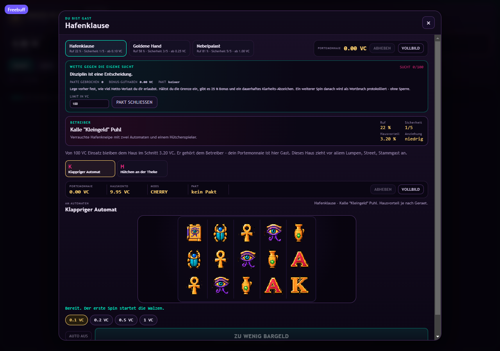

</td>
<td width="50%">

**Kartentische**
Authentisches Blackjack gegen den Dealer, Video-Poker und klassischer Tischpoker mit echten Kartendecks.

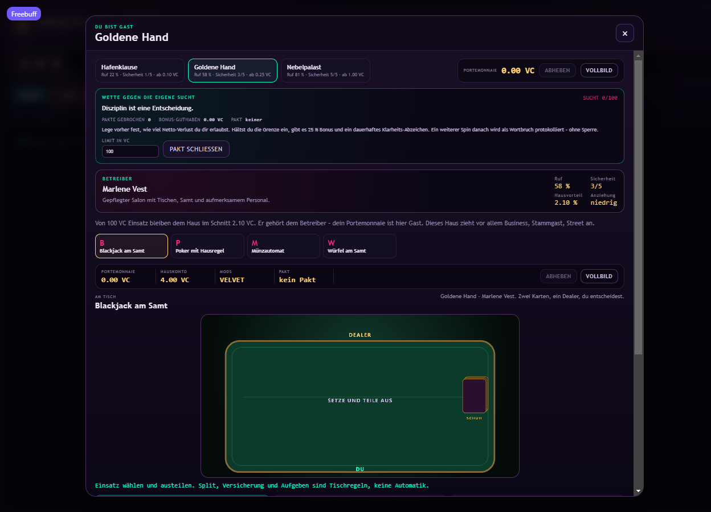

</td>
</tr>
<tr>
<td width="50%">

**Roulette & Würfel**
Französisches Roulette mit vollem Tableau und Würfelspiele (Craps) für Veteranen des grünen Filzes.

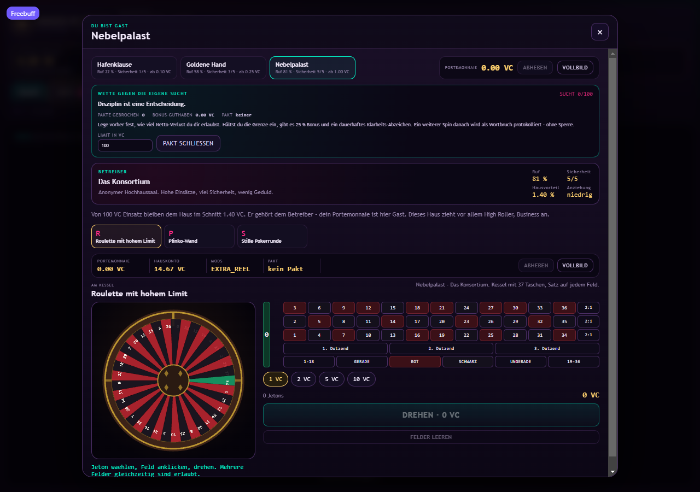

</td>
<td width="50%">

**Plinko-Wand**
Keine Würfel-Simulation, sondern pure Physik! Kugeln prallen an echten Stiften ab, bis sie in den Fächern landen.

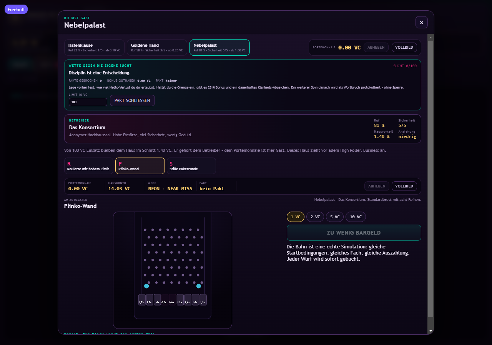

</td>
</tr>
</table>

### 3. Gäste mit Gedächtnis und Marotten
Die Besucher sind keine gesichtslosen Pixel, sondern gehören fünf ausgeprägten Personas an:
- **Der Lumpen-Zocker:** Dreht jeden Cent dreimal um, verfällt schnell der Sucht und fängt Streit an, wenn das Bier warm ist.
- **Der Straßenjunge:** Zockt gerne an Hütchen und Würfeln, ist flink auf den Beinen und bringt Kumpels mit.
- **Der Stammgast:** Kommt regelmäßig wieder – aber nur, wenn sein Lieblingsplatz frei ist und er sich an einen guten Vorbesuch erinnert.
- **Der Geschäftsmann:** Setzt höhere Summen, verlangt saubere Toiletten und hat wenig Geduld für Schlangestehen.
- **Der High Roller:** Bringt dicke Bündel mit, fordert edles Samt-Ambiente und kann das Haus mit einem einzigen Glücksgriff an den Rand des Ruins treiben.

Gäste merken sich, wie sie behandelt wurden. Ein Gast, der pleite geht und verdurstet, kommt mit schlechter Laune wieder – oder hetzt die Nachbarschaft auf.

### 4. Streit, Fäuste und Hinterhof-Duelle
Wo Alkohol fließt und Ersparnisse verdampfen, fliegen gelegentlich die Fäuste. Wütende Gäste zetteln Streitigkeiten an. Jetzt hast du die Wahl:
- Einen teuren Security-Wachmann vorschicken, der die Lage professionell klärt.
- Oder selbst die Ärmel hochkrempeln: Tritt dem Rädelsführer im rundenbasierten Nahkampf gegenüber! Deine Kampffertigkeit (`brawl`) und Nehmerqualitäten (`endurance`) entscheiden über Sieg oder Krankenhausaufenthalt. Ein Sieg begeistert die Menge – eine Niederlage kostet dich deine Barschaft und bringt dir blaue Flecken ein, die dich tagelang ausbremsen.
- Hinter dem Haus wartet die Leiter: sechs herausforderbare Gegner mit eigenem Startgeld und Preisgeld, die du im Charakterfenster antrittst. Jeder Kampf landet mit Ergebnis, Runden und KO im Archiv; deine Bilanz und die Gegnerhistorie liest das Spiel von dort, nicht aus einem zweiten Zähler.

### 5. Das Geld-Drama: Zwei Töpfe, eine Wahrheit
In *Rigged by Design* gilt ein unumstößliches Gesetz: **Geschäft ist Geschäft, und privat ist privat.**
- **Das Hauskonto:** Gehört der Spielhalle. Daraus werden Automaten bezahlt, Gehälter überwiesen, Reparaturen finanziert und Gästegewinne beglichen.
- **Dein Portemonnaie:** Dein persönliches Bargeld. Du kannst es dir als Privatentnahme vom Hauskonto auszahlen – aber nur, wenn der Betrieb eine gesunde Reserve behält.
- **Wenn das Haus pleitegeht:** Gewinnt ein Gast den Jackpot und das Hauskonto ist leer, wird der Gewinn nicht etwa magisch gelöscht. Er steht als knallharte Verbindlichkeit im Buch. Du schuldest dem Gast sein Geld – und die Zinsen schlafen nicht.

### 6. Die Konkurrenz: Zu Besuch bei den Rivalen
Wird es dir im eigenen Laden zu eng, nimmst du das Smartphone und fährst zu den Rivalen der Stadt:
- **Die Hafenklause:** Kalle „Kleingeld" Puhls verrauchte Hafenkneipe mit billigen Automaten und Hütchenspielern.
- **Die Goldene Hand:** Marlene Vests gepflegter Salon mit Samttischen, feinem Personal und strengen Hausregeln.
- **Der Nebelpalast:** Ein anonymer Hochhaussaal des Konsortiums mit brachialen Limits, Plinko-Wänden und eiskalter Atmosphäre.

Dort kannst du dein persönliches Taschengeld verspielen oder an den Arbeitsstationen ehrliche Schichten schieben (Putzen, Bierausschank, Croupier, Mechaniker), um dein Portemonnaie wieder aufzupäppeln. Doch Vorsicht: Die Rivalen schlafen nicht – sie spionieren dich aus, werben dir Gäste ab oder schicken nachts Saboteure vorbei, die deine Automaten kurzschließen.

---

## Visueller Rundgang: Licht, Dreck und Pixel-Poesie

### Die Evolution der Spielhalle

  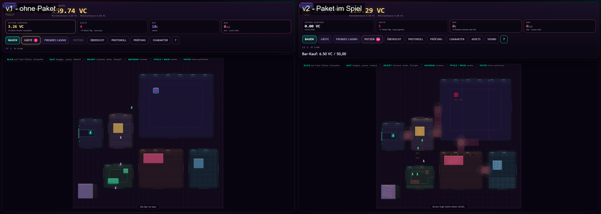

<em>Links die karge Kachelwüste der frühen Tage, rechts dieselbe Etage nach dem großen Grafik- und Licht-Update.</em>

**Was sich verändert hat:**
- **Licht statt schwarzer Löcher:** Räume wirken nicht mehr wie isolierte Boxen, sondern erzeugen mit gedimmten Vignetten, Deckenstrahlern und Neonreflexen echte Kasino-Atmosphäre.
- **Direktes Boden-Feedback:** Beim Klick leuchtet das Kachelziel auf, Schrittspuren zeigen den Weg und Hindernisse werden sauber umlaufen.
- **Interaktive Steuerung:** Ein aufgeräumtes HUD mit Schnellzugriffen, Portemonnaie-Anzeige, XP-Fortschritt und Tagesphasen.

### Die Spielbühnen im Detail

<table>
<tr>
<td align="center" width="33%">
<strong>Blackjack am Samt</strong> 

</td>
<td align="center" width="33%">
<strong>Texas Hold'em Poker</strong> 
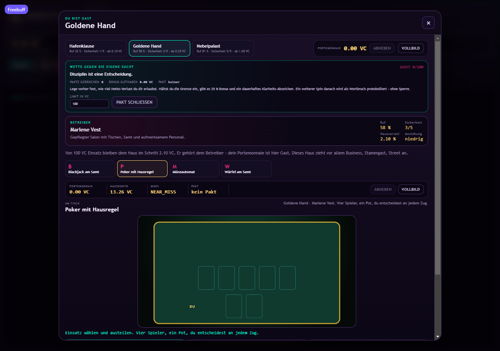
</td>
<td align="center" width="33%">
<strong>Roulette-Kessel</strong> 

</td>
</tr>
<tr>
<td align="center" width="33%">
<strong>Plinko-Physik</strong> 

</td>
<td align="center" width="33%">
<strong>Smartphone-Zentrale</strong> 
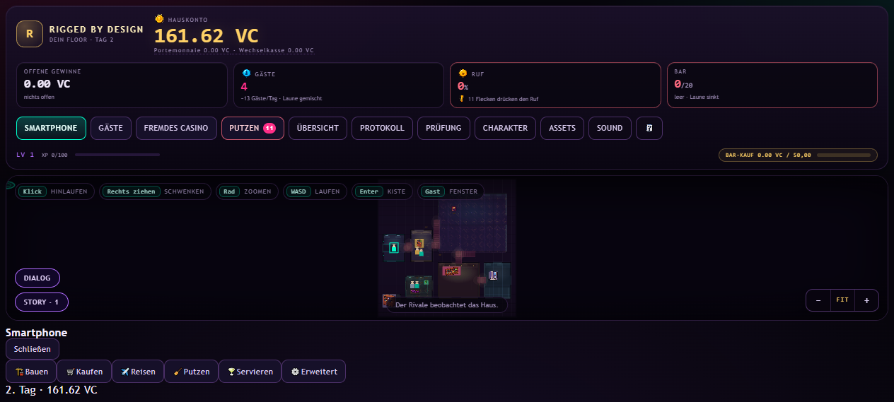
</td>
<td align="center" width="33%">
<strong>Charakter-Spiegel</strong> 
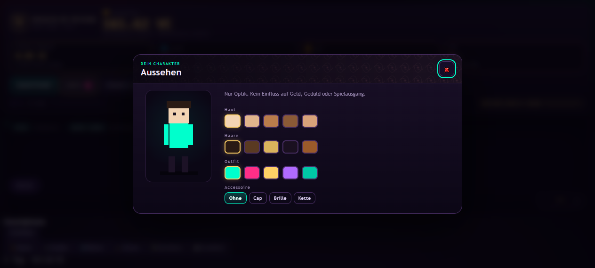
</td>
</tr>
</table>

### Betreiber vs. Gast: Zwei Perspektiven

<table>
<tr>
<td align="center" width="50%">
<strong>Als Betreiber</strong> 
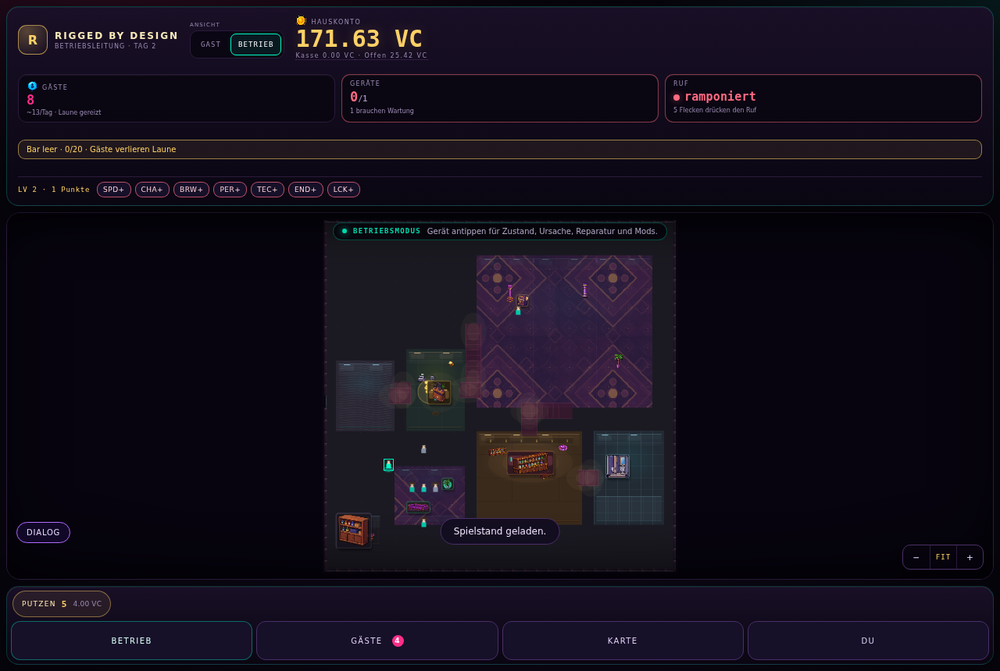
</td>
<td align="center" width="50%">
<strong>Als Gast</strong> 
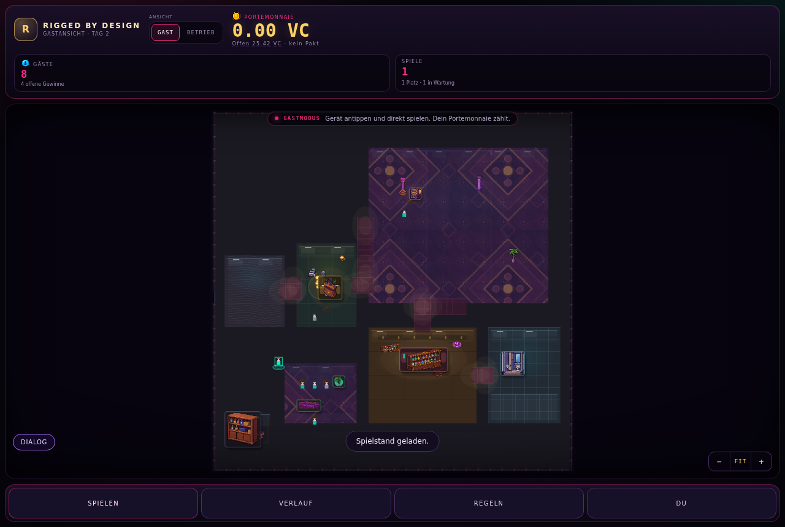
</td>
</tr>
</table>

---

## Die Versionen-Chronologie: Vom Kachel-Koma zur Metropole

Wie jedes gute Casino wurde auch dieses nicht an einem Nachmittag erbaut. Ein Blick in die Bauakten:

### Ära 1: Der Urknall im Kachel-Nirvana (v0.1 – v0.3.27)
- Die Geburtsstunde: Ein Charakter bewegt sich über ein nacktes 32×32-Raster.
- Erste Slot-Maschinen spucken Zahlen aus, Wände sind noch schwarze Balken.
- Das doppelte Buchführungssystem wird eingegossen: Kein Cent darf ohne Gegenbuchung entstehen.

### Ära 2: Es werde Licht & Textur (v0.3.28 – v0.3.114)
- Das große Grafik-Update: Über 500 handgezeichnete Texturen, animierte Automaten, rauchige Bars und Holzvertäfelungen halten Einzug.
- Räume bekommen Deckenlampen und abgestufte Lichtpfützen.
- Gäste entwickeln Persönlichkeiten: Lumpen, Stammgäste und Schnösel bringen unterschiedliche Launen und Budgets mit.

### Ära 3: Rivalen, Fäuste & Pity-Schalter (v0.3.115 – v0.3.180)
- Die Stadt erwacht: Kalle Puhl, Marlene Vest und das Nebelpalast-Konsortium eröffnen ihre Läden. Der Spieler kann via Smartphone hinreisen.
- Das Duell-System: Streithähne lassen sich im rundenbasierten Schlagabtausch persönlich zur Räson bringen.
- Automaten bekommen Pity-Mechaniken und Entladungs-Spins.

### Ära 4: Das Zeitalter der Erinnerungen & Facts (v0.3.181 – Heute)
- Die Narrative Engine erwacht: Gäste erinnern sich an vergangene Besuche und reagieren nachtragend oder spendabel.
- Das Plinko-Brett wird auf echte physikalische Kollisionen umgestellt.
- Save-System v11: Spielstände sichern jeden Cent, jeden Fleck und jede Rivalen-Beziehung verlustfrei ab.

---

## Der Masterplan: Vom Startguthaben zum Konzern-Netzwerk

Die Entwicklung folgt einem klaren, sechsphasigen Masterplan mit 30 fokussierten Etappen:

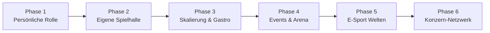

1. **Phase 1: Das eigene Überleben sichern (Agent 01–06)**  
   Du stehst selbst auf der Matte: Spiele an deinen eigenen Automaten mit deinem privaten Wallet, übernimm bezahlte Arbeitsschichten auf dem Floor, trainiere deine 7 Rollenspiel-Attribute (von Charisma bis Zähigkeit), trage Hinterhof-Duelle aus und behalte alles im persönlichen Dashboard im Blick.
2. **Phase 2: Eigentum & Echte Spielhalle (Agent 07–13)**  
   Kaufe deine allererste echte Immobilie (vom heruntergekommenen Kiosk bis zum Tanzschuppen), renoviere sie Kachel für Kachel, installiere neue Automaten, tune Gewinnchancen und schalte Roguelite-Items mit verrückten Synergien frei.
3. **Phase 3: Der Aufstieg zum Entertainment-Tempel (Agent 14–21)**  
   Unternehmensprogression von der *Bude* über die *Kasse* und den *Saal* bis zum *Konzern*. Binde Stammgäste an dich, delegiere Aufgaben an Manager, eröffne eine voll ausgestattete Gastronomie-Bar, richte eine Tanzfläche mit DJ ein und lenke hybride Besucherströme zwischen Kasino, Lounge und Club.
4. **Phase 4: Die Arena & Das große Spektakel (Agent 22–25)**  
   Baue eine eigene Kampfsport-Arena in deiner Location! Veranstalte Turniere, lasse lokale Kämpfer antreten und eröffne virtuelle Sportwetten-Märkte mit Quotenberechnung und Kassen-Abrechnung.
5. **Phase 5: Die E-Sport-Revolution (Agent 26–28)**  
   Simulierte digitale Wettbewerbe: Gründe oder empfange E-Sport-Teams, verfolge deterministische Match-Serien (Best-of-Three / Best-of-Five) und biete Wetten auf Kartensieger und Turnierchampions an.
6. **Phase 6: Das Firmen-Imperium (Agent 29–30)**  
   Ein Casino reicht dir nicht mehr? Verwalte ein ganzes Portfolio an unterschiedlichen Standorten (Hauptcasino, Nachtclub, Sportbar, Eventhalle) über ein zentrales Konzern-Netzwerk.

*(Alle Details und technischen Spezifikationen der 30 Etappen sind in der [Roadmap-Dokumentation](docs/ROADMAP.md) hinterlegt).*

---

## Häufig gestellte Fragen

<strong>Ist das hier ein typischer Tycoon- oder Idle-Manager?</strong>

Nein. Wenn du darauf wartest, dass Zahlen von alleine steigen, während du Kaffee trinkst, wirst du zusehen, wie dein Laden vermüllt, Gäste durstig abhauen und dein Automat den Geist aufgibt. *Rigged by Design* ist eine aktive Lebenssimulation: Du läufst selbst über den Boden, sprichst mit Leuten, trägst Kisten und löst Probleme mit Köpfchen (oder den Fäusten).

<strong>Kann ich echtes Geld einzahlen oder gewinnen?</strong>

Um Himmels willen, nein! VaCoins sind zu 100 % fiktive Spielwährung. Es gibt keine Krypto-Anbindung, keine In-App-Käufe und keine Auszahlungen. Das Spiel parodiert die Mechanismen der Branche – es beutet dich nicht aus.

<strong>Warum zahlt mir der Automat meinen Gewinn nicht bar aus?</strong>

Weil dein eigenes Hauskonto vielleicht gerade leer ist, weil du vorher zu viele teure Teppiche gekauft hast! Gewinne werden nicht herbeigezaubert: Kann das Haus nicht zahlen, steht der Betrag als Schuld im Buch. Du musst erst wieder Umsatz machen, um deine eigenen Gäste auszuzahlen. Ehrliche Buchhaltung tut manchmal weh.

<strong>Warum schlägt mich ein Gast im Kasino zusammen?</strong>

Weil er stundenlang verloren hat, der Automat keinen Cent ausgespuckt hat, die Bar leer war und du ihm im Vorbeigehen eine freche Bemerkung gedrückt hast. Gäste haben Grenzen – und wenn du im Duell verlierst, erleidest du echte Verletzungen, die dich langsamer laufen lassen.

<strong>Kann ich das Spiel speichern und morgen weiterspielen?</strong>

Ja. Spielstände werden lokal abgespeichert. Unser Save-System sichert nicht nur dein Geld, sondern jeden Kieselstein, die Laune jedes Besuchers und die offenen Rachepläne deiner Rivalen.

<strong>Was unterscheidet das von einem klassischen Casino-Simulator?</strong>

Alles. Du bist kein unsichtbarer Direktor, der auf Tabellenkalkulationen starrt. Du bist ein Typ mit löchrigen Schuhen, der seinen eigenen Boden wischt, seine Gäste verprügelt (oder von ihnen verprügelt wird), sich zwischen Privatinsolvenz und dem ersten Stammgast bewegt und abends auf einem vererbten Sofa fernsieht, bis ihm die Augen zufallen. Es ist das Leben – mit Hausvorteil.

---

## Für Maschinisten & Code-Schrauber

Du willst nicht nur spielen, sondern unter die Haube schauen, an den Zahnrädern drehen oder eigene Erweiterungen beisteuern? 

Alle technischen Details, mathematischen Nachweise, Architekturverträge, Entwickler-Befehle und Qualitäts-Gates sind sauber ausgelagert:
- Die vollständige Doku-Landkarte findest du im [`docs/INDEX.md`](docs/INDEX.md).
- Die technischen Kernregeln und Verträge stehen im [`AGENTS.md`](AGENTS.md) und in der [`docs/ARCHITECTURE.md`](docs/ARCHITECTURE.md).
- Die Testlinie und Nachweise sind in [`docs/TESTING.md`](docs/TESTING.md) dokumentiert.

---

## Ein ernster Absatz, ganz ohne Neonrahmen

Dieses Spiel greift satirisch und schonungslos Mechanismen auf, die Glücksspiel in der Realität so gefährlich machen: Near-Miss-Effekte, Pity-Illusionen, emotionale Verstärker und schleichende Suchtdynamiken. Wir simulieren diese Systeme, um sie transparent, begreifbar und entzaubert darzustellen.

Falls Glücksspiel für dich oder jemanden in deinem Umfeld in der realen Welt zu einem Problem geworden ist: Die [Bundeszentrale für gesundheitliche Aufklärung (BZgA)](https://www.bzga.de/) bietet kostenlose, anonyme und kompetente Hilfe unter **0800 1 37 27 00**. Das meinen wir völlig ohne Ironie.

---

  <strong>Rigged by Design.</strong> 
  Das Spiel ist gezinkt. Das Leben auch. Jetzt mach was draus.

