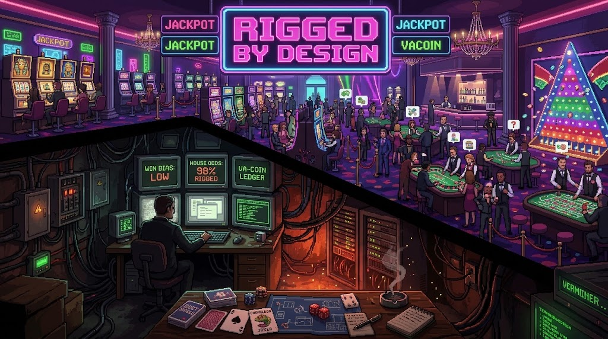
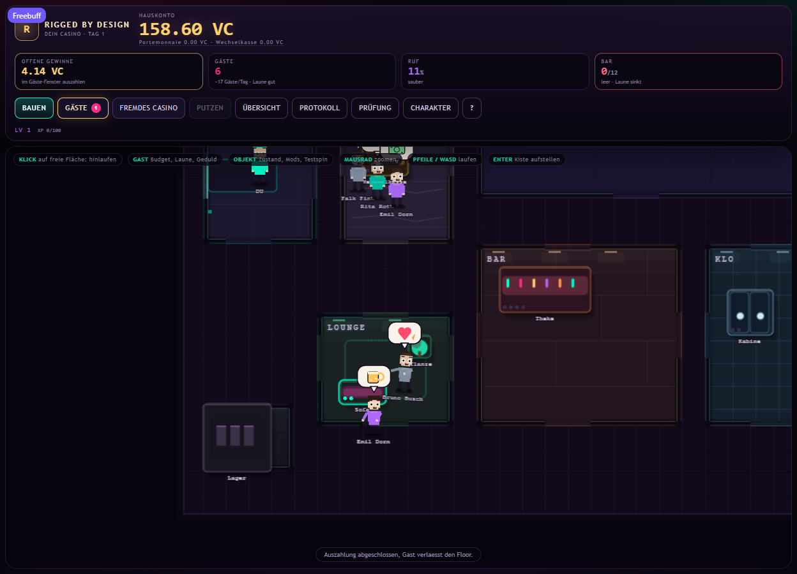
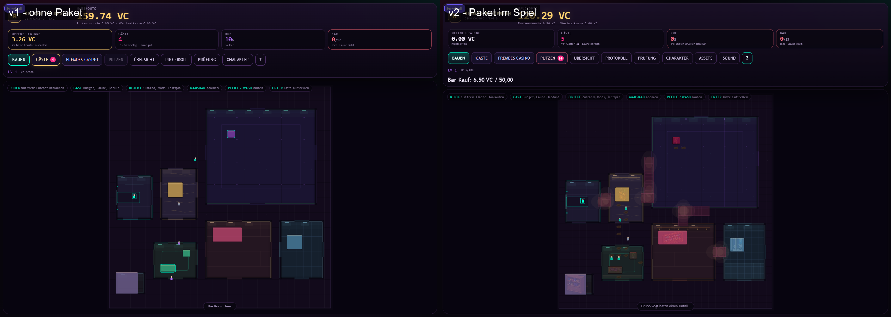
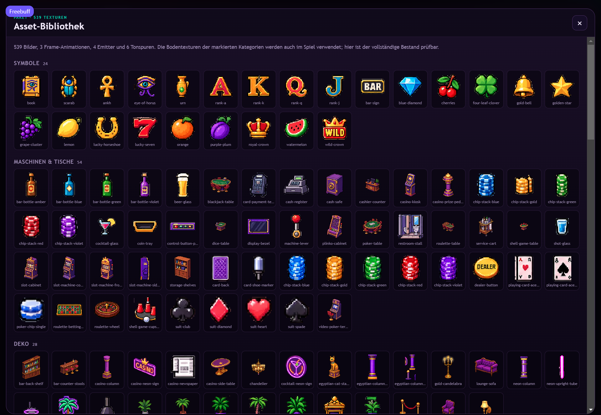
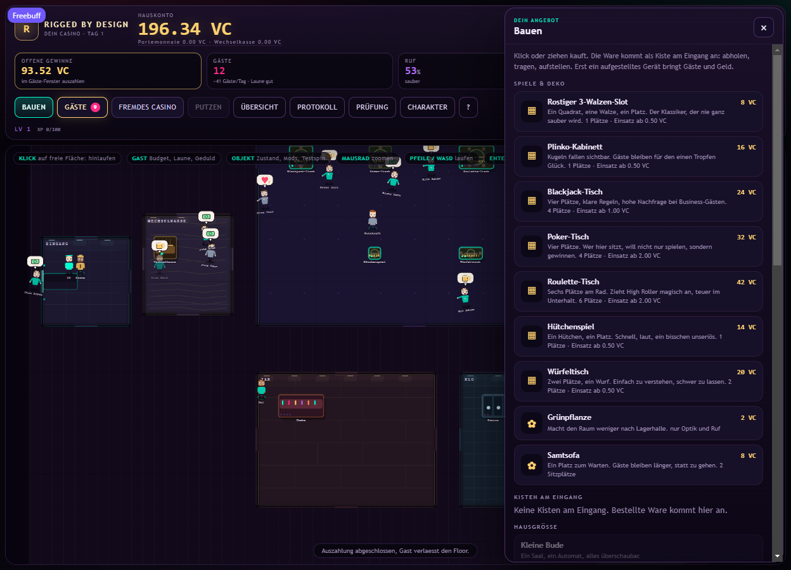
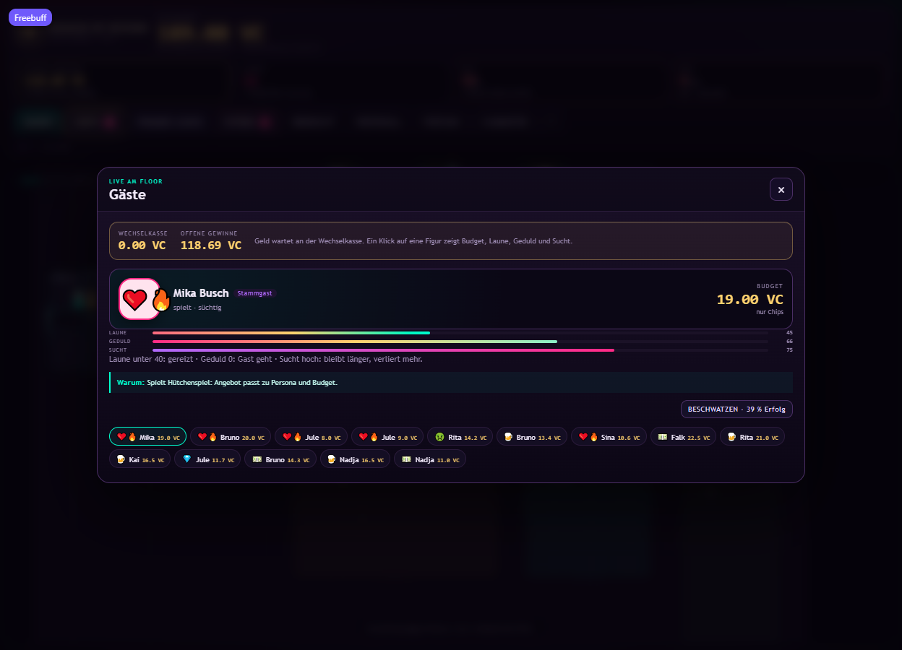
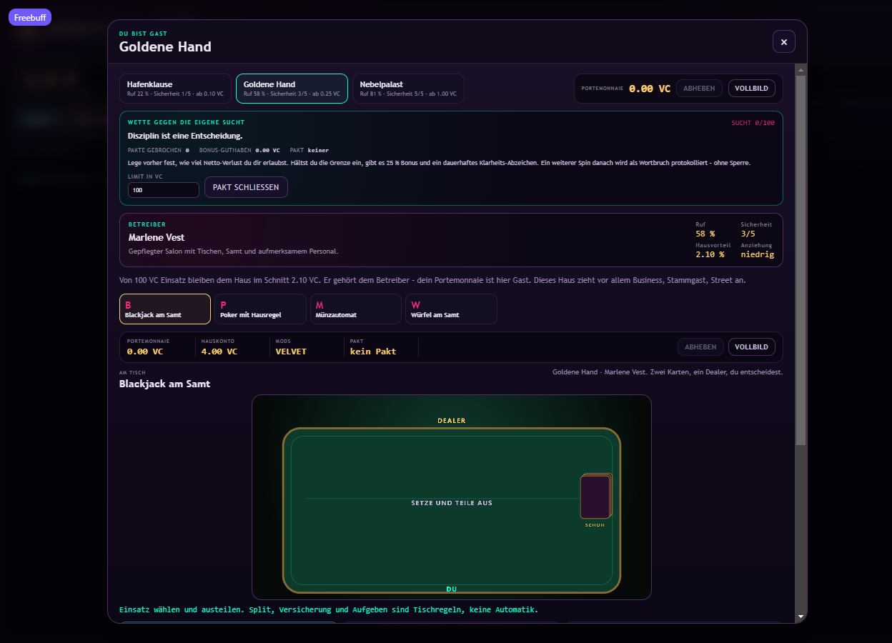
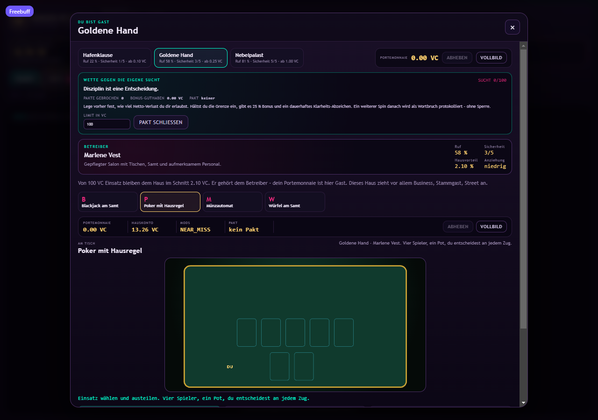
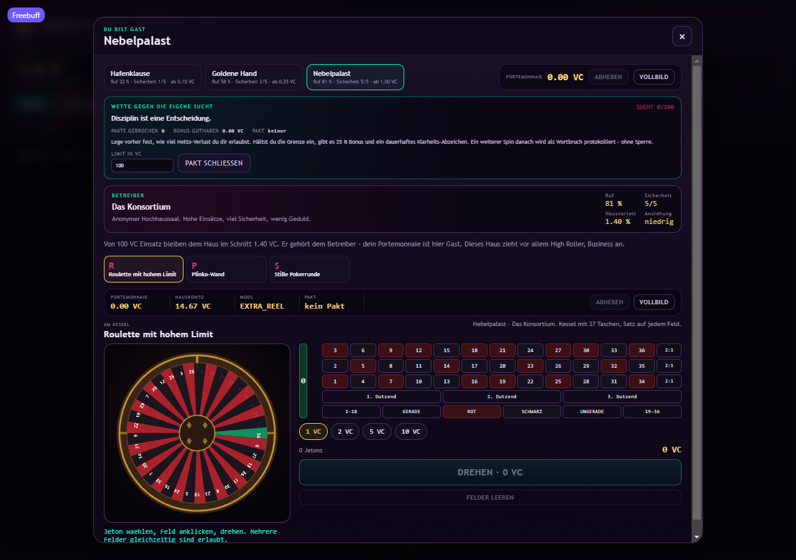
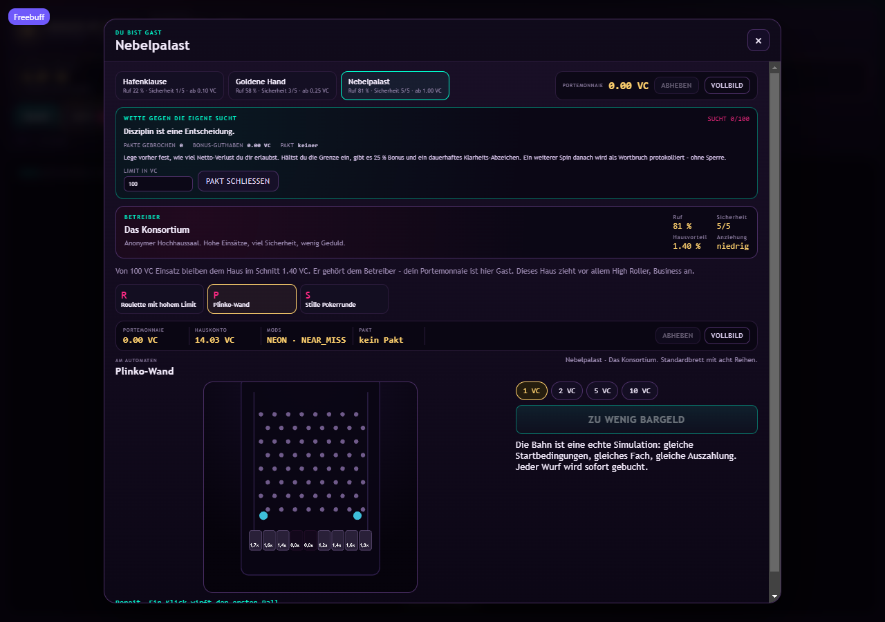

# Rigged by Design

<p align="center">
  
</p>

<h1 align="center">Rigged by Design</h1>

<p align="center">
  <strong>Ein Casino-Simulator über Hausvorteile, Hausaufgaben und die erstaunliche Haltbarkeit eines kaputten Sofas.</strong><br>
  Du führst das Haus. Das Haus führt Buch. Die Gäste führen sich selbst – meistens in die falsche Richtung.
</p>

<p align="center">
  <a href="https://github.com/vannon091118/rigged-by-design/actions/workflows/ci-verify.yml"></a>
  <a href="https://github.com/vannon091118/rigged-by-design/tags"></a>
  
  
</p>

> Die Konsolenwerte im Banner sind Teil der Satire, keine Spielregeln oder Balancing-Angaben. Für den heutigen Stand siehe die Abschnitte weiter unten.

> „Der Hausvorteil ist kein Bug. Er ist die Geschäftsidee.“

**Rigged by Design** ist eine satirische Aufbausimulation: Du richtest ein Casino ein, kümmerst dich um Gäste, Personal und laufende Kosten und darfst anschließend herausfinden, dass „Umsatz“ und „Geld auf dem Konto“ zwei verschiedene Erzählperspektiven sind.

Das hier ist zugleich eine Einladung in die Spielwelt und die Werkbank für Entwicklerinnen und Entwickler. Was folgt, beschreibt den **heutigen Projektstand**. Mechaniken und Umfang dürfen sich mit dem Spiel verändern; für konkrete Regeln gelten Code, Tests und die verlinkten Architekturverträge.

---

## Ein Nachlass mit sehr viel Kleingedrucktem

Dein Vater hat dir keine Villa hinterlassen. Er hat dir einen Schlüssel, einen Spielautomaten und einen Ordner voller Belege vermacht, in dem auffällig oft das Wort „Jackpot“ vorkommt und erstaunlich selten das Wort „Ersparnisse“.

Der Automat war offenbar sein Lieblingsprojekt. Das Guthaben darin ist es weniger. Zwischen dem letzten Kassenbon und einer Bedienungsanleitung, die „Geduld“ für eine Strategie hält, bleibt immerhin ein Ladenlokal. Du bekommst zum Start **150 VC Startkapital** und einen **kostenlosen Automaten**. Die Bank nennt das vermutlich „nicht ausreichend besichert“. Wir nennen es eine Tutorial-Entscheidung.

Jetzt darfst du herausfinden, ob aus Neonlicht, einer Wechselkasse und etwas zu viel Optimismus ein Geschäft wird. Die Gäste kommen mit eigenem Budget, eigener Laune und eigenen Vorstellungen davon, wie lange ein Getränk dauern darf. Du kommst mit einem Schlüsselbund und dem Verdacht, dass dein Vater die Steuerordner absichtlich alphabetisch sortiert hat.

Falls das Startkapital schneller verschwindet als der Nachlassordner: In den Casinos der Konkurrenz kannst du auch Schichten annehmen. Reinigung, Bar, Kartentisch oder Reparatur – der Kapitalismus bietet erstaunlich viele Wege, im selben Gebäude zu arbeiten, in dem man später wieder Geld ausgibt.

<p align="center"><em>Die vierte Wand ist vorhanden. Sie steht nur auf der Kostenliste unter „Renovierung“.</em></p>


## Dein erster Abend im Haus

Der aktuelle Einstieg lässt sich ungefähr so spielen:

1. **Öffne „Bauen“** und prüfe, was du auf deiner Etage platzieren kannst. Der erste Automat ist bereits bezahlt – eine seltene Erfolgsmeldung.
2. **Hol eine Kiste ab, trag sie zum Platz und stell sie auf.** Der Betrieb beginnt mit Logistik. Das glamouröse Ende ist noch nicht freigeschaltet.
3. **Lass Gäste herein.** Sie wechseln am Kassenschalter Fiat in Spielchips und suchen sich anschließend selbst ein Angebot aus.
4. **Behalte offene Gewinne im Blick.** Gewinne, die Gäste noch nicht abgeholt haben, sind eine Verbindlichkeit und kein stilles Trinkgeld.
5. **Richte Preise, Spiele, Mods und Service ein.** Eine Bar kann die Stimmung heben; ein leerer Kühlschrank beweist vor allem, dass auch Pixel Durst haben.
6. **Stell Personal ein oder bediene selbst.** Beides funktioniert im aktuellen Stand. Nur eine Variante lässt dich so tun, als wäre alles delegiert.
7. **Besuche ein fremdes Casino.** Dort kannst du nach den Regeln eines anderen Hauses spielen oder an Jobstationen Schichten übernehmen. Endlich Verantwortung abgeben – manchmal sogar mit Lohnzettel.

Der Floor ist die zentrale Bühne: Du bewegst dich darin, platzierst Geräte und sprichst Gäste oder Objekte an. Die Simulation läuft weiter, während Fenster geöffnet sind. **Escape** schließt ein Fenster; es hält die Zeit nicht an. Das Haus ist höflich genug, dich zu informieren, aber nicht höflich genug, auf dich zu warten.

## Was heute auf dem Spielplan steht

Die folgenden Systeme sind im gegenwärtigen Spielstand sichtbar. Das ist eine Momentaufnahme und keine Festschreibung dessen, was das Spiel später sein muss.

| Bereich | Heute im Projekt |
| --- | --- |
| **Casino-Floor** | Etage mit Geräten, Deko, Gästen und begehbarem Spielercharakter |
| **Gäste** | Budget, Laune, Geduld, Persona und Sucht beeinflussen Auswahl und Besuchsverlauf |
| **Betrieb** | Preise, Mods, Reparaturen, Reinigung, Bar und Personal wirken auf das Haus |
| **Kasse** | Fiat-Wechsel, Hauskonto, privates Portemonnaie und noch offene Auszahlungen werden getrennt geführt |
| **Spiele** | Slot, Blackjack, Tischpoker, Video Poker, Roulette, Plinko, Würfel und Hütchenspiel |
| **Fremde Häuser** | Der eigene Charakter kann als Gast an fremden Spielen teilnehmen |
| **Aushilfsjobs** | Bei Rivalen lassen sich Aufgaben in Reinigung, Bar, Kartenspiel oder Reparatur übernehmen |
| **Spielstände** | Lokale Saves enthalten Welt, Journal, Look und Narrativzustand |

Die Auswahl kann sich ändern. Die Dokumente [Produktstand](docs/PRODUCT.md), [Architektur](docs/ARCHITECTURE.md) und [Roadmap](docs/ROADMAP.md) halten den aktuellen Rahmen und die geplanten nächsten Schritte fest.

### Bilder aus dem heutigen Betrieb





Links steht die frühere Etage, rechts derselbe Stand mit dem aktuellen Geräte-, Tisch- und Deko-Paket.

Das Asset-Paket umfasst derzeit 539 Texturen, drei Frame-Animationen, vier Emitter und sechs Tonspuren. Im Spiel findest du die Bibliothek unter **ASSETS**. Sie zeigt, was tatsächlich geladen ist – ein selten ehrlicher Blick hinter die Kulissen.



### Ein Rundgang, statt acht Marketingversprechen

| Momentaufnahme | Screenshot |
| --- | --- |
| Geräte, Deko und Preise im Bau-Panel |  |
| Gäste mit Laune, Geduld und Besuchsstatus |  |
| Blackjack-Tisch mit Dealer und Karten-Shoe |  |
| Poker mit Board und eigenen Karten |  |
| Roulette-Kessel und gesetzte Jetons |  |
| Plinko-Brett mit Bahn und Fachquoten |  |

Weitere Screenshots und Versionsvergleiche liegen in [`docs/screenshots/`](docs/screenshots/). Das Asset-Inventar und die technische Verdrahtung stehen in [`docs/ASSETS.md`](docs/ASSETS.md).

## Wie das Haus Geld zählt

VaCoins sind fiktive Spielwährung. Sie haben **keinen Echtgeldwert**. Intern ist ein VC in 10.000 ganzzahlige Mikro-Einheiten aufgeteilt; die Anzeige als Dezimalzahl ändert daran nichts. Jede Buchung bleibt eine Ledger-Zeile – selbst die Buchung, die du lieber nicht sehen würdest.

Im aktuellen Modell begegnen dir vier Konten:

| Konto | Bedeutung |
| --- | --- |
| **Hauskonto** | Betriebsmittel des Casinos |
| **Portemonnaie** | Privates Geld der spielenden Person |
| **Wechselkasse** | Umtauschstelle für die fiktive Fiat-Währung der Simulation |
| **Offene Gewinne** | Bereits gewonnene, noch nicht ausgezahlte Beträge |

Gäste wählen Spiele und Einsätze anhand ihres aktuellen Zustands und der Angebote im Haus. Gewinne können als offene Auszahlung stehenbleiben. Ausgaben für Betrieb, Personal, Reparaturen und Ausbau konkurrieren mit diesem Geldbedarf. Das ist der Managementteil: Nicht jeder schöne Umsatz ist schon ein schöner Kontostand.

## Wegweiser durch die Spielwelt

Die README erzählt die Welt mit einem Augenzwinkern. Wenn du nachschlagen willst, was ein System **heute tatsächlich** tut, geh zur Quelle:

| Thema | Quelle |
| --- | --- |
| Umfang und Produktstand | [`docs/PRODUCT.md`](docs/PRODUCT.md) |
| Systeme, Zustandsbesitz und Datenfluss | [`docs/ARCHITECTURE.md`](docs/ARCHITECTURE.md) |
| Speicherstände und Migration | [`docs/ARCHITECTURE.md`](docs/ARCHITECTURE.md), `src/store/save.ts` |
| Narrativ-Facts, Gäste-Erinnerungen und Content-Vertrag | [`docs/NARRATIVE-ENGINE.md`](docs/NARRATIVE-ENGINE.md) |
| Geplante Arbeit | [`docs/ROADMAP.md`](docs/ROADMAP.md) |
| Prüfungen und Eskalation | [`docs/CI-GATES.md`](docs/CI-GATES.md), [`docs/ESCALATION.md`](docs/ESCALATION.md) |
| Fehlercodes | [`docs/ERROR_CATALOG.md`](docs/ERROR_CATALOG.md) |
| Änderungsverlauf und Inventur | [`docs/CHANGELOG.md`](docs/CHANGELOG.md), [`docs/DEVTAGEBUCH.md`](docs/DEVTAGEBUCH.md), [`docs/INVENTORY.md`](docs/INVENTORY.md) |

### Die Erzählung ist ebenfalls im Bau

Die Narrative Engine ist ein wachsender Teil des Projekts. Der aktuelle Vertrag beschreibt Facts als Ereignisse aus echten Zustandsübergängen; Texte stellen diese Ereignisse dar, sie erzeugen keine Spielregeln. `Guest` bezeichnet einen Besuch, `Visitor` die wiederkehrende Identität. Der persistente Narrativzustand liegt in `WorldState`; der Save-Stand ist v9 und Migrationen unterstützen v5 bis v8.

Die Roadmap führt die nächsten Narrative-Schnitte einzeln auf. Deshalb versprechen Figuren, Erinnerungen oder künftige Ereignisse hier keine fertige Story-Kampagne. Selbst die vierte Wand braucht erst ein Ticket.


## Entwicklerstart

Du brauchst **Node.js 22** (mindestens `22.22.2`) und **pnpm 10.4.1**. Das Werkzeug-Setup liegt gesammelt in `src/Config/`; die Skripte binden diese Konfigurationen explizit ein. pnpm-spezifische Sicherheits-Overrides für transitive Pakete stehen im `pnpm.overrides`-Abschnitt der `package.json`.

```sh
pnpm install --frozen-lockfile
pnpm run dev
```

Vite startet unter <http://localhost:3000>. Für die kurze lokale Prüfkette:

```sh
pnpm run verify:quick
```

Die volle lokale Pipeline und die Testbefehle:

```sh
pnpm run verify:all
pnpm run test
pnpm run typecheck
pnpm run lint
pnpm run build
pnpm run agent:context
pnpm run agent:verify --profile=quick
```

`verify:quick` ist Entwicklungsfeedback mit zehn schnellen Gates. `verify:all` prüft alle zwölf Gates und ist vor Releases sowie bei Änderungen an Dependencies, Ledger, RNG oder Saves erforderlich. Lange Statistik- und Soak-Nachweise laufen in GitHub Actions; `pnpm run ci:long` stößt sie an und wartet auf das Ergebnis. Berichte liegen unter `.verify-cache/reports/`. Die [CI-Gate-Dokumentation](docs/CI-GATES.md) erklärt, welche Prüfung zu welcher Änderung gehört.

Für den optionalen Android-Wrapper baut `pnpm run android:apk` eine Debug-APK; `pnpm run android:apk:release` legt eine nicht signierte Release-APK ab. Beide Varianten brauchen das Android-SDK.

Die Prüfpipeline ist lesend; automatische Reparaturen laufen getrennt über `pnpm run fix`. Vor einem Beitrag gelten die Verträge aus [`AGENTS.md`](AGENTS.md), besonders: Änderungen auf Branches, Pflichtdoku im selben Commit und genau ein Narrative-Content-Beitrag pro abgeschlossenem Turn.

## Entwicklerkarte

```text
src/
├── core/       headless Simulation, Regeln, RNG, Ledger und Spiele
├── store/      Welt-, Ledger-, RNG-, Zeit- und Save-Besitz
├── ui/         React-Oberfläche und Fensterzustand
├── render/     PixiJS-Floor, Effekte, Audio und Darstellung
└── Config/     Vite-, TypeScript-, ESLint- und Capacitor-Konfiguration
content/
└── narrative/  Beiträge und Vokabular; Text ist Darstellung, keine Regel
docs/
└──             Architektur, Produktstand, Roadmap, Verträge und Screenshots
scripts/
└──             Prüfketten, Doku-Generatoren und Entwicklungswerkzeuge
```

Ein paar Verträge, die das Repo vor dem Casino-Frühstück schützt:

- **Ein Zustandsbesitzer:** `world-store` besitzt Welt, Ledger, PRNG, Uhr und Saves; React hält nur UI-Zustand.
- **Headless Core:** `src/core/` importiert keine Browser-APIs.
- **Geld:** ganzzahlige Mikro-Einheiten, keine Floats; Geld entsteht nur über den vorgesehenen externen Weltpfad und wird immer gebucht.
- **Zufall:** Gameplay- und Darstellungs-RNG teilen keinen Strom. Kein direkter Wanduhr- oder Zufallszugriff in Core und Scripts.
- **Karten:** ein gezogener Schuh-Kartenstapel verliert die gezogene Karte; neu gemischt wird erst, wenn er leer ist.
- **Narrativ:** Facts folgen tatsächlichen Übergängen; Journal und Narrativzustand bleiben getrennt. Texte entscheiden nie über Kosten oder Effekte.

Die Details und Ausnahmen stehen in [`AGENTS.md`](AGENTS.md) und den jeweiligen Dokumentverträgen. Wenn eine Pointe und ein Invariant kollidieren, gewinnt das Invariant. Es hat bessere Tests.


## Roadmap: die nächste Runde ist noch nicht ausgeteilt

Die Roadmap beschreibt Absichten und Abhängigkeiten, keine Garantie für endgültige Spielmechaniken.

| Horizont | Richtung laut aktuellem Plan |
| --- | --- |
| **Jetzt** | Eine gemeinsame Impact- und Gate-Auswertung, belastbare Dokumentation und sichtbare Prüfresultate |
| **Als Nächstes** | Narrative Engine schrittweise erweitern: Beziehungen, Trigger, Scheduler und Event-Verträge |
| **Später** | Autonome Rivalen, casinoübergreifende Aktionen und Langzeitnachweise für Narrative-Ereignisse |

Der jeweils aktuelle Stand lebt in [`docs/ROADMAP.md`](docs/ROADMAP.md). Abgeschlossene Punkte wandern von dort in den Changelog; sie bleiben nicht als ewige Prophezeiung im README stehen.

## FAQ – bevor der Kassenschluss wieder verschoben wird

<details>
<summary><strong>Ist das echtes Glücksspiel?</strong></summary>

Nein. Es gibt keine Echtgeld-Einzahlung, keine Auszahlung und keinen realen Gewinn. VaCoins sind fiktive Simulationseinheiten.
</details>

<details>
<summary><strong>Welche Mechaniken sind schon spielbar?</strong></summary>

Der aktuelle Stand zeigt einen begehbaren Casino-Floor mit Gästen, Betriebssystemen und mehreren Spieltypen. Die Tabelle „Was heute auf dem Spielplan steht“ fasst den sichtbaren Umfang zusammen; einzelne Regeln können sich weiterentwickeln.
</details>

<details>
<summary><strong>Gibt es Accounts oder Multiplayer?</strong></summary>

Der dokumentierte Stand ist ein lokales Einzelspieler-Spiel ohne Account-System. Spielstände werden lokal verwaltet.
</details>

<details>
<summary><strong>Wo finde ich die Regel hinter einer Pointe?</strong></summary>

In den verlinkten Verträgen und im Code. Die README soll den Einstieg erleichtern, nicht die Implementierung überstimmen.
</details>

<details>
<summary><strong>Kann ich helfen?</strong></summary>

Ja. Lies zuerst `AGENTS.md`, prüfe den passenden Vertrag unter `docs/` und halte Änderungen in einem eigenen Branch. Nach Änderungen werden die sechs Pflichtdokumente im selben Commit aktualisiert. Für Narrative liefert jeder abgeschlossene Turn genau einen Beitrag unter `content/narrative/contributions/`.
</details>

## Ein ernster Absatz, ohne Neonrahmen

Das Spiel greift bewusst satirisch Mechaniken auf, die Glücksspiel attraktiv und riskant machen können: Near Misses, variable Einsätze und Gäste mit Suchtwerten. Es ist eine Simulation über solche Systeme, kein Glücksspielangebot. Falls Glücksspiel für dich aufgehört hat, ein Spiel zu sein, ist die [BZgA](https://www.bzga.de/) ein besserer Ansprechpartner als dieses Repository. Das meinen wir ohne Ironie.

<p align="center"><strong>Rigged by Design.</strong><br>Das Haus gewinnt immer. Wer heute das Haus ist, darfst du herausfinden.</p>
