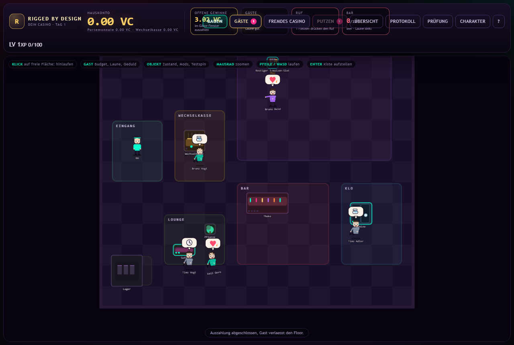
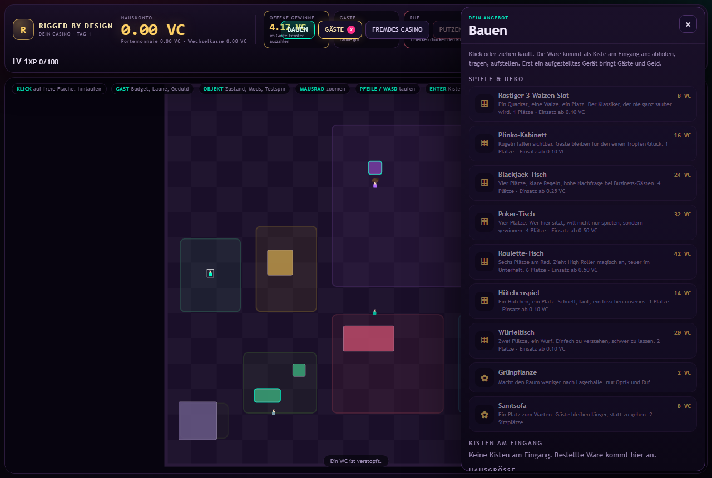
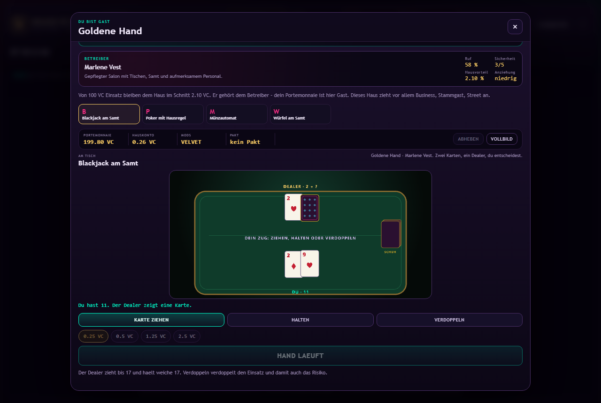
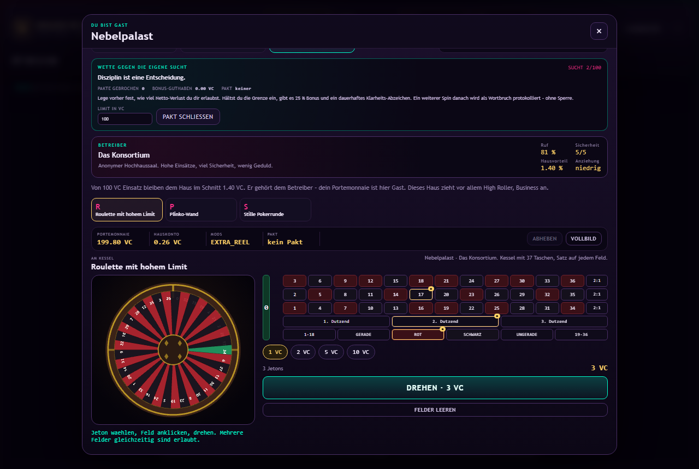
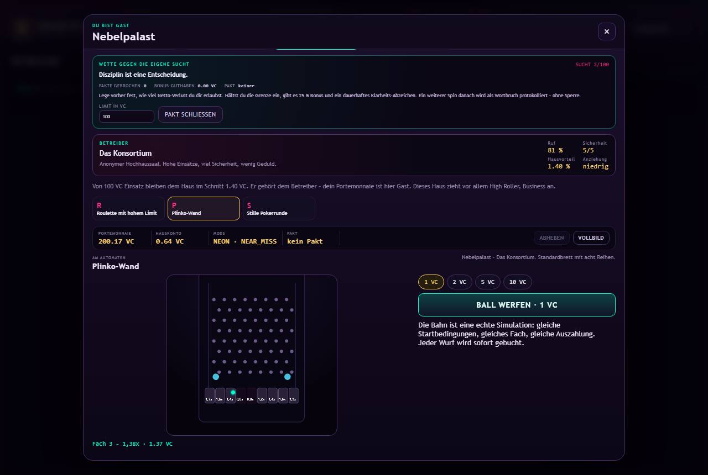
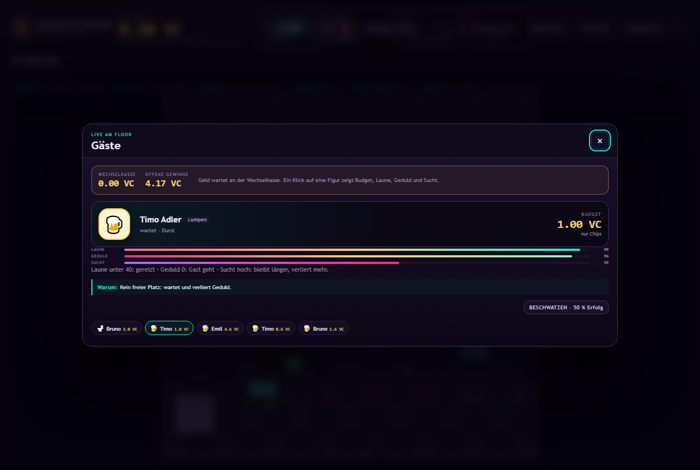

  

<h1 align="center">Rigged by Design</h1>

  <strong>Dein Casino. Deine Gäste. Deine Buchhaltung. Deine Schuld.</strong> 
  Ein Aufbauspiel über den einzigen Ort, an dem „Der Kunde ist König“ ein schlechtes Geschäftsmodell ist.

> „Der Hausvorteil ist kein Bug. Er ist die Geschäftsidee.“

Willkommen in **Rigged by Design**, dem Casino-Simulator, in dem du nicht spielst. Du besitzt. Klingt erst einmal nach einem Upgrade. Ist es auch – bis dir auffällt, dass Besitz Miete, Löhne, kaputte Sofas und Gäste mit Meinungen bedeutet.

Kein Echtgeld. Keine echten Casinos. Nur VaCoins, ein paar sehr entscheidungsfreudige Pixelmenschen und ein Haus, das jeden Tag ein bisschen mehr frisst.

## Die Idee (und warum sie ein Finanzamt braucht)

Du startest mit **0,00 VC** und **einem gratis Automaten**. Das ist keine Challenge, das ist eine Diagnose.

Deine Gäste betreten das Casino am Eingang, wechseln an der Kasse Fiat in Chips und suchen sich selbst einen Platz. Manche spielen, manche trinken, manche gehen aufs Klo – und alle entscheiden anhand von **Laune, Geduld, Sucht, Budget und Persona**, ob dein Angebot zu ihnen passt. Du hast dagegen einen Ruf, eine Bar, die immer leer ist, und die vage Hoffnung, dass niemand das Sofa anfasst.

Es gibt genau **ein Bild**: den Floor. Keine Tabs, keine Dashboard-Spalten, keine Exceltabelle mit Glücksspiel-Ästhetik. Okay, doch: Die Buchhaltung gibt es auch. Aber sie versteckt sich hinter „Prüfung“, weil wir wissen, wie Menschen auf Buchhaltung reagieren.

Der Reiz ist nicht, Slot-Mathematik zu lernen. Der Reiz ist, **Mods, Spiele und Preise zu einer Kombination zu bauen**, die genau die Gäste anzieht, die bleiben, trinken und irgendwann süchtig werden – und nicht die, die wütend werden und dein Mobiliar beschädigen. Es sei denn, du zahlst für einen Türsteher. Der ist billiger als das Sofa. Meistens.

Fremde Casinos sind der Ort, an dem **du Gast bist**. Dort spielst du mit deinem eigenen Portemonnaie gegen die Hausregeln anderer Besitzer. Endlich mal nicht verantwortlich. Nur zahlend.

## In sieben Schritten zum respektablen Etablissement

1. **Bauen öffnen.** Der erste Automat steht gratis. „Gratis“ heißt hier: Du zahlst mit deiner Zeit.
2. **Kiste abholen, tragen, aufstellen.** Ein Casino besteht zu achtzig Prozent aus Logistik und zu zwanzig Prozent aus Leuten, die glauben, es sei Glücksspiel.
3. **Gäste kommen lassen.** Sie wechseln an der Wechselkasse Fiat in Chips. Geld wechselt die Form, nicht den Besitzer. Noch nicht.
4. **Offene Gewinne auszahlen.** Nicht auszahlen spart Geld. Und kostet Gäste. Und Ruf. Und alles.
5. **Preise, Mods und Bar einrichten.** Die Bar ist kein Service. Die Bar ist Klebstoff in Getränkeform.
6. **Personal einstellen.** Es putzt, zapft und schlichtet, während du woanders bist. Das nennt man Vertrauen. Oder Lohnfortzahlung.
7. **Fremdes Casino besuchen.** Dort bist du endlich Gast – also der, der zahlt. Der Kreis schließt sich. Leider mit deinem Geld.

## Der Kreislauf des Geldes (es kreist selten zu dir zurück)

Gäste kommen nicht wegen eines Timers, sondern wegen Ordnung, Zustand deiner Geräte, Personal und Attraktion. Sie setzen ein, gewinnen oder verlieren, und was sie gewinnen, wartet als **offene Auszahlung** an der Kasse. Du zahlst aus. Danach kaufst du Spiele, Deko, Mods, Walzen, Personal, Reinigung und Reparaturen. Der Rest ist Gewinn. Theoretisch.

Praktisch ist der Rest meistens ein Sofa.

## Die vier Töpfe (keiner davon ist ein Sparschwein)

| Topf | Wofür |
| --- | --- |
| **Hauskonto** | Das Geld des Casinos. Es gehört dem Haus. Also dir. Also dem Finanzamt, das es nicht gibt. |
| **Portemonnaie** | Dein privates Bargeld. Du kommst nur heran, indem du es dem Hauskonto wegnimmst. Der einzige Diebstahl, den dieses Spiel erlaubt. |
| **Wechselkasse** | Hier wird Fiat zu Chips. Der Gast denkt, er tauscht Geld. Er tauscht die Illusion. |
| **Offene Gewinne** | Geld, das Gäste gewonnen und noch nicht abgeholt haben. Es wartet. Es drückt. Es ist die ehrlichste Verbindlichkeit im Spiel. |

Jeder VaCoin ist eine Buchung. Das ist der langweiligste Satz in dieser Beschreibung und der einzige, auf den wir wirklich stolz sind.

## Die Spiele (alle fair, bis auf die, die es nicht sind)

Sieben Spiele, sieben Charaktere – und ein Testspin, der nichts kostet, weil der Betreiber nicht gegen sein eigenes Haus spielt. Am eigenen Automaten siehst du also nur zu. In fremden Häusern wird mit richtigem Portemonnaie-Geld gespielt.

- **Slot:** Fünf Walzen, drei Reihen, zehn Linien, BOOK als Wild und Scatter, Freispiele und eine Risiko-Karte nach jedem Gewinn. Der einzige Automat, bei dem du die Walzen sehen kannst, ohne dass jemand „nur noch ein Spin“ sagt.
- **Blackjack:** Ziehen, halten, verdoppeln. Der Dealer zieht bis 17. Du bis zur Einsicht.
- **Video Poker:** Fünf Karten, neun Zeilen, halten oder tauschen. Endlich ein Spiel für Menschen mit Entscheidungsschwäche.
- **Roulette:** 37 Taschen, jeder Jeton eine echte Wette. Die Kugel lügt nicht. Der Rest schon.
- **Plinko:** Ein Ball, viele Stifte, echte Physik. Das ist kein Glück, das ist Schwerkraft mit Selbstbewusstsein.
- **Würfel:** Zwei faire Würfel, fünf Felder. Fair. Das ist der Running Gag dieses Casinos.
- **Hütchenspiel:** Drei Becher, eine Perle. Du wählst, der Geber mischt, die Perle entscheidet. Wie im echten Leben, nur mit weniger Steuern.

## Gäste (keine Statisten, leider)

Laune unter 40: gereizt. Geduld auf 0: der Gast geht. Sucht hoch: bleibt länger, verliert mehr. Und wenn die Bar leer ist, sinkt die Laune, als hätte jemand das Konzept „Gastfreundschaft“ gestrichen.

Du kannst selbst bedienen: an die Bar gehen, einen Drink zapfen, ihn einem Gast bringen. Oder Personal einstellen und so tun, als hättest du alles im Griff. Beides ist gültig. Eines ist ehrlicher.

## Steuerung (Maus, Tasten, Hoffnung)

| Ort | Aktion |
| --- | --- |
| **Floor** | Freie Fläche: Charakter läuft dorthin. Gast: Budget, Laune, Geduld, Sucht. Objekt: Zustand, Mods, Testspin. |
| **Bauen** | Spiel oder Deko anklicken und auf den Floor setzen – oder direkt aus dem Panel ziehen. |
| **Mausrad** | Zoomen. Die Übersicht bleibt lesbar, die Details werden teurer. |
| **Pfeile / WASD** | Laufen. Ein Feld pro Schritt, wie im echten Leben, nur ohne Parkplatzsuche. |
| **Enter** | Getragene Kiste abstellen oder Getränke und Ersatzteile abladen. |
| **Escape** | Fenster schließen. Die Simulation läuft weiter; sie wartet nicht auf dich. |

## Warum „Rigged by Design“?

Weil „Casino-Simulator“ nach Software klingt und „Rigged by Design“ nach einer Produkthaftungsklage. Wir nehmen beides.

Der Name ist Programm: Das Haus ist manipuliert, die Gäste sind simuliert, und du bist der einzige echte Fehler im System.

## Was du nicht erwarten solltest (eine Liste, die wir ernst meinen)

- **Kein Echtgeld, keine Einzahlung, kein Gewinn.** VaCoins sind fiktiv. Deine Entscheidungen sind es nicht.
- **Kein Multiplayer, keine Accounts.** Dein Fortschritt bleibt auf deinem Gerät. Wie deine Motivation, wenn die Bar zum dritten Mal leer ist.
- **Keine vollständigen Tisch-Engines.** Kein Split, keine Versicherung, keine Side Pots. Wir sind ein Aufbauspiel, kein Turnier. Das nennen wir „fokussiert“.
- **Keine moralische Erlösung.** Der Hausvorteil bleibt. Auch für dich.

## Ernst gemeint (der einzige Abschnitt ohne Pointe)

Dieses Spiel simuliert bewusst suchtfördernde Mechaniken: Near Misses, Gewinne, die wie Verluste aussehen, steigende Einsätze, Gäste mit Geduld und Sucht. Das ist Satire über Glücksspielprodukte, kein Glücksspielprodukt. Es gibt kein Echtgeld, keine Einzahlung und keinen Gewinn, der irgendwo ankommt.

Wenn Glücksspiel für dich aufgehört hat, ein Spiel zu sein, ist die [BZgA](https://www.bzga.de/) ein besserer Ansprechpartner als dieses Repository. Das meinen wir ohne Ironie.

## Schlusswort (mit Pointe)

**Rigged by Design.** Das Haus gewinnt immer. Du bist das Haus. Viel Erfolg.
