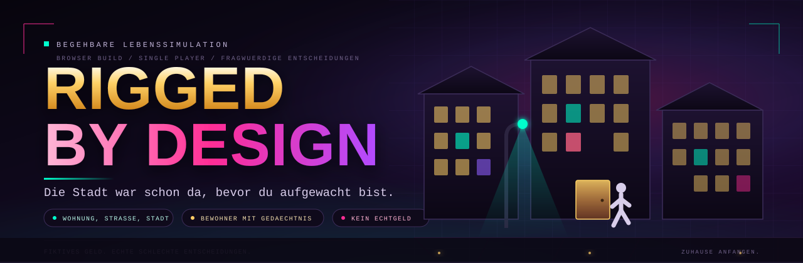
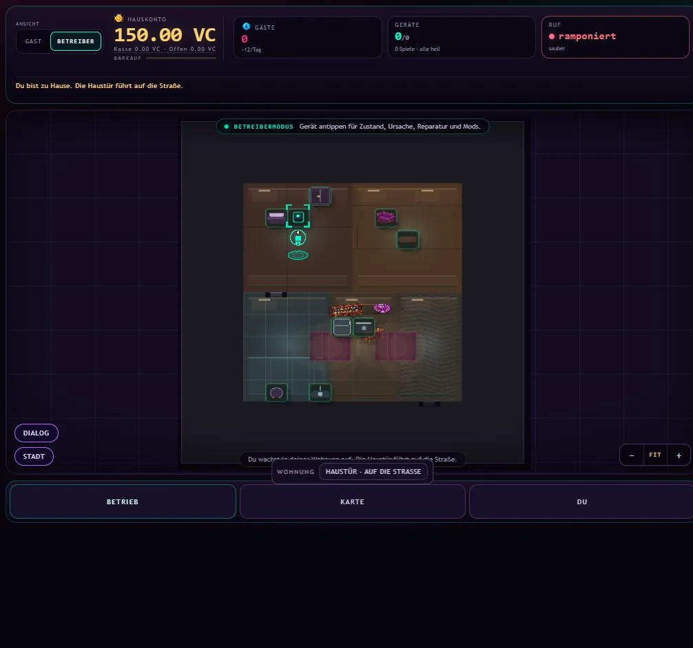
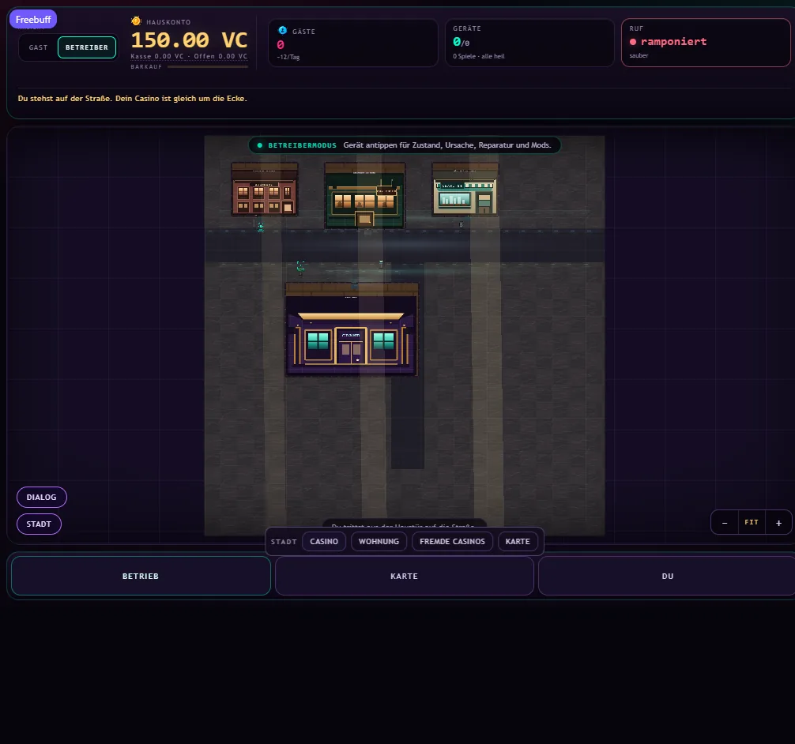
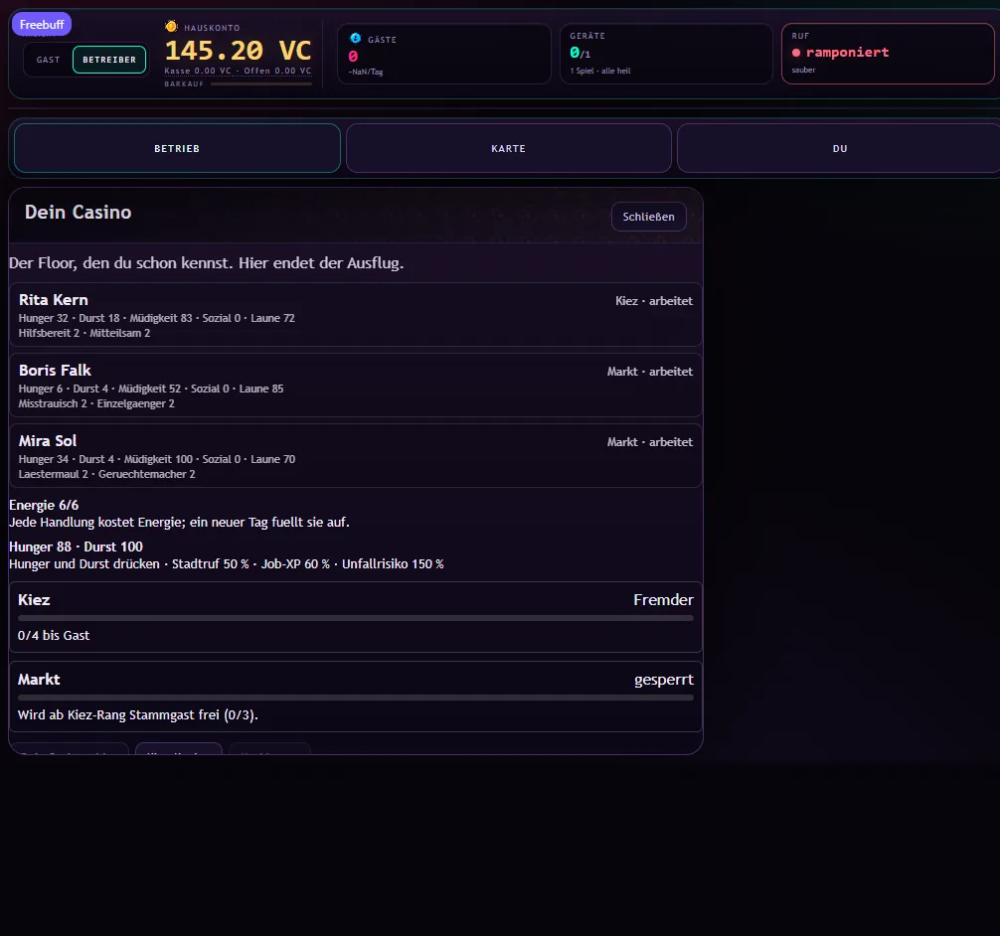
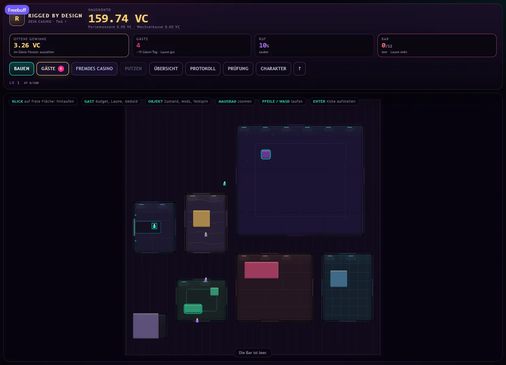
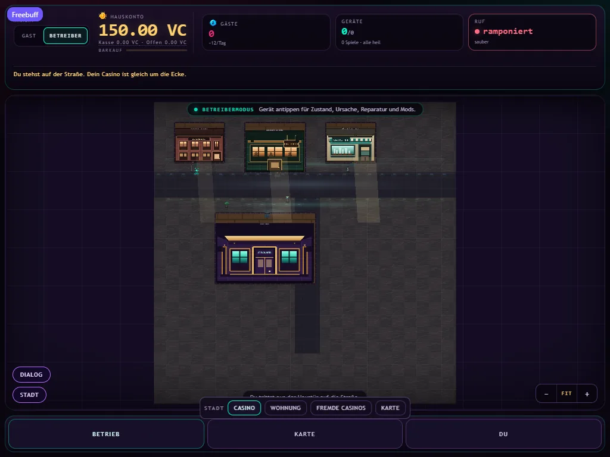
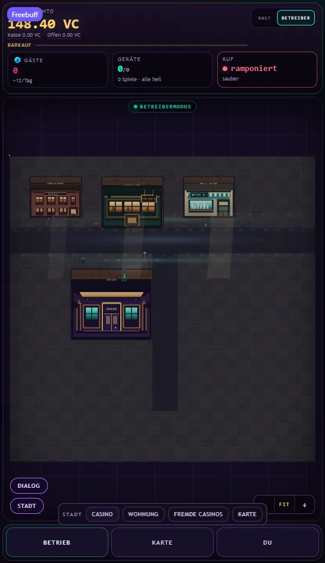

  

  
  
  
  

<h3 align="center"><em>„Der Hausvorteil ist kein Softwarefehler. Er ist die Geschäftsidee des Universums.“</em></h3>

  Eine zynisch-humorvolle Lebenssimulation über schlechte Entscheidungen, schmutzige Böden, 
  das unbarmherzige Gesetz der Wahrscheinlichkeit und die erstaunliche Haltbarkeit eines vererbten Sofas.

  Diese Seite ist für alle geschrieben, die spielen wollen – nicht für alle, die Code lesen wollen. 
  Kein Dateiname, keine Technik, keine Ausreden. Nur du, deine Wohnung und eine Stadt, die nicht auf dich gewartet hat.

---

## Du wachst in deiner Wohnung auf

Sie ist nicht groß. Das Wasser aus dem Hahn braucht drei Minuten, bis es lauwarm wird, die Heizung gluckert nachts wie ein ertrinkender Matrose, und der Nachbar über dir übt seit Monaten Schlagzeug – ohne jedes Rhythmusgefühl, aber mit bewundernswerter Ausdauer. Auf dem Tisch liegt dein Smartphone mit fünf ungelesenen Nachrichten, die du lieber nicht öffnest, und die Kaffeemaschine verteilt mehr Kaffeesatz als Heißgetränk. Aber sie ist dein Zuhause. Das, was übrig bleibt, wenn man keine Ausreden mehr hat.

  

<em>Bett, Kochnische, Bad, Flur. Und eine Haustür, die direkt auf die Straße führt.</em>

Du klickst dich nicht durch ein Menü. Du stehst auf, nimmst dein Smartphone und öffnest die Tür. Dahinter liegt keine Etage, kein Level und kein Ladebildschirm, sondern eine Straße, die auch ohne dich funktioniert. Das ist der ganze Trick dieser Simulation: Du bist nicht der Mittelpunkt. Du bist nur der Einzige, der gerade aufgewacht ist.

---

## Die Stadt ist das Spiel

**Das hier ist kein Casino-Spiel.** Der Laden mit den Automaten ist ein Gebäude unter vielen – deine Startbude und die Werkbank, auf der Geld- und Wahrscheinlichkeitsmechaniken geprüft werden. Das Genre ist die Stadt: Wohnung, Straße, Nachbarschaft, Leute mit eigenen Plänen.

Maja aus dem zweiten Stock eilt jeden Morgen um 7:14 Uhr zur Frühschicht und schaut demonstrativ auf den Boden, wenn du ihr im Treppenhaus begegnest. Der Kiosk an der Ecke riecht nach altem Zeitungspapier und Kaugummi; der Besitzer kennt deinen Vornamen, aber nicht aus Zuneigung, sondern weil Stammkunden die unangenehme Angewohnheit haben, wiederzukommen. Autos rollen über nasses Pflaster, Ampeln schalten stur von Rot auf Grün, und die Tauben auf den Fenstersimsen haben schon klügere Pläne geschmiedet als die meisten Menschen unten auf der Straße.

  

<em>Der Kiez schläft nie ganz. Er döst höchstens kurz ein, bis die Straßenbahn quietscht.</em>

Die Leute um dich herum sind keine Pappaufsteller. Sie haben Wohnungen, Arbeitsplätze, Hunger, Durst, Müdigkeit und eine Laune, die man ihnen ansieht. Sie schlafen, pendeln zur Arbeit, trinken nach Feierabend ein Bier und erinnern sich daran, wer ihnen gestern gegenübergestanden hat. Wer einem Nachbarn auf der Straße folgt, sieht ihn die Tür aufstoßen und drinnen wieder dieselbe Person – niemand wird beim Raumwechsel gelöscht oder neu gewürfelt.

  

<em>Gespräche entstehen, wenn man sich begegnet. Ob man will oder nicht.</em>

Und ja: irgendwo zwischen Spätkauf, Waschsalon und Dönerbude steht dein Laden. Du kannst ihn aufbauen, putzen, betreiben – oder erst einmal durch die Stadt laufen und herausfinden, wer hier eigentlich wohnt. Beides ist ein legitimer Lebensentwurf. Einer davon bezahlt die Miete.

---

## Was heute läuft

Keine Versprechen, sondern das, was der aktuelle Stand tatsächlich tut:

- **Wohnung als Raum:** Du startest im Bett, nicht in einem Menü. Bett, Kochnische, Bad und Flur sind begehbar; die Haustür führt direkt auf die Straße.
- **Straße und Stadt:** Gebäude mit echten Türen, Gehwege, Laternen und ein Tageslauf von morgens bis nachts. Kiez, Markt und dein Laden sind Orte, keine Buttons – du gehst hin und stehst davor.
- **Bewohner mit eigenem Kopf:** Tagesabläufe, Arbeitsplätze, Hunger, Durst, Müdigkeit und Laune. Begegnungen bleiben hängen – bei dir und bei ihnen. Ein Gast, der gestern leer ausging, kommt heute nicht mit Blumen wieder.
- **Dein Laden:** Starter-Kiste huckepack tragen, Gerät aufstellen, Kasse öffnen, Gäste bedienen, Boden wischen, Bar kaufen. Wer nicht putzt, verliert Kundschaft; wer nicht serviert, verliert Gäste; wer beides nicht tut, verliert den Laden.
- **Arbeit und Miete:** Am Tagesende wollen Miete und Strom bezahlt sein. Für die Handlungen in der Stadt hast du sechs Einheiten Energie; jeder neue Tag füllt sie wieder auf.
- **Geld, das ehrlich weh tut:** VaCoins sind ganzzahlige Spielwährung ohne Echtgeld. Jede Bewegung steht im selben Buch; kann die Kasse einen Gewinn nicht auszahlen, steht der Rest als Schuld da, bis wieder Umsatz reinkommt.
- **Smartphone als Abkürzung:** Bauen, Kaufen, Reisen, Putzen, Servieren, Inbox, Vitter, ImmoLuck. Alles davon geht auch direkt in der Welt – das Gerät nimmt dir nur die Laufwege ab.
- **Speichern und weiterspielen:** lokal, inklusive Pfützen, Launen und offener Rechnungen. Was du anrichtest, bleibt angerichtet.

---

## Der Plan: MVP

Der MVP ist kein Konzeptpapier, sondern ein Abend, der funktioniert: **Der erste Abend trägt.** Du wachst auf, du gehst raus, du stellst etwas auf die Beine – und am Ende des Tages weißt du, ob du morgen Miete zahlen kannst. Genau das ist der Maßstab, an dem hier alles gemessen wird: Trägt es einen Abend, ist es drin. Trägt es keinen, ist es Deko.

**Was der MVP kann:**

- **Der erste Abend:** Eröffnung, Aufwachen, Haustür, Straße, dein Laden. Ein Einstieg, ein Gast, ein bedienbarer Floor.
- **Wohnung und Stadt als Raum:** kein Menü-Hüpfen, kein Teleport. Was hinter einer Tür liegt, erreichst du zu Fuß – und dieselben Leute, die draußen herumlaufen, stehen drinnen wieder vor dir.
- **Ehrliche Darstellung:** Was du siehst, läuft wirklich so. Kein Platzhalter, keine Kulisse, keine geliehenen Materialien.

**Was noch Baustelle ist:**

- **Wirtschaft und Events:** Bar, Club, Arena, Wetten und E-Sport sollen die Stadt erst noch zum Vibrieren bringen.
- **Inhalt und Erzählung:** Das Ziel sind anderthalbtausend gewertete Textbausteine – die Stadt soll mehr zu sagen haben.
- **Abnahme und Release:** Leistung, Geräte, Präsentation. Erst wenn das sitzt, wird aus der Simulation ein Release.

Was hier als Plan steht, ist gebaut, sobald es läuft – alles andere steht ehrlich unter Baustelle. Versprochen wird nichts, was der Build nicht belegt.

---

## Ein Abend von vorn bis hinten

So fühlt sich der Spiellauf an, vom ersten Blinzeln bis zum Tagesabschluss:

Du schlägst die Eröffnung weg und stehst in deiner Wohnung. Bett, Kochnische, Bad – alles da, nichts davon bezahlt sich von selbst. Also: Schuhe an, Smartphone ein, **Haustür auf**. Die Stadt empfängt dich mit nassem Pflaster und der Mitteilung, dass dein Laden gleich um die Ecke steht. Er steht leer, versteht sich. Leere Räume, eine Kasse und eine Kiste am Eingang, die niemand für dich trägt.

Du schleppst die Starter-Kiste durch den Raum – ja, zu Fuß, ja, das dauert – und stellst den ersten Automaten auf eine freie Fläche. Erst dann kommt der erste Gast. Erst dann fließt das erste Geld. Die Fortschrittsleiste über allem kennt immer genau ein Ziel: erst das Gerät, dann das Bargeld für die Bar, dann Tagesmiete plus Strom aus dem Hauskonto, dann die nächste Firmenstufe. Ein Ziel zur Zeit. Das Leben ist kompliziert genug.

Zwischendurch: ein Gast verschüttet etwas Klebriges, die Theke wird ranzig, jemand wird laut, weil die Walzen „gezinkt“ waren – sie waren es nicht, die Mathematik ist nur ehrlich. Du wischst, du redest, du kassierst, du servierst. Das Smartphone klingelt: Lieferant, Nachbar, Vergangenheit – irgendwer will immer Geld. Am Tagesende machst du Kasse, zahlst Miete und Strom und fällst ins Bett. Morgen ist auch noch ein Tag. Morgen will die Stadt wieder Miete.

Und falls du dich fragst, ob sich das lohnt: Die Alternative ist, auf dem vererbten Sofa sitzen zu bleiben, bis dir vor dem Röhrenfernseher die Augen zufallen. Auch das ist eine Entscheidung. Sie zahlt nur keine Miete.

---

## Rundgang

  

<em>Dein Laden am ersten Tag: leere Räume, eine Kasse und eine Kiste, die niemand für dich trägt.</em>

  

<em>Dieselbe Straße, später am Abend. Das Licht bleibt an, ob du willst oder nicht.</em>

  

<em>Alles, was du brauchst, ist eine Tür weiter. Alles, was du nicht brauchst, auch.</em>

---

## Doku-Stand: Wo was zu finden ist

Spielen braucht kein Vorwissen; Nachlesen schon gar kein Codeverständnis. Hier steht, wo was liegt:

| Du willst … | Dann schau hier |
| --- | --- |
| Spielen | Rechner an, Repo holen, `pnpm install`, dann `pnpm dev` – die Simulation läuft im Browser. |
| Neu hier oder lange weg | **Neu dabei? Klonen.** Schon eingezogen? Dann reicht ein **Pull** für den neuesten Stand. |
| Wissen, was als Nächstes kommt | [`docs/governance/ROADMAP.md`](docs/governance/ROADMAP.md) und [`docs/ROADMAP-DETAIL.md`](docs/ROADMAP-DETAIL.md) – der Plan und sein Kleingedrucktes. |
| Sehen, was sich zuletzt geändert hat | [`docs/CHANGELOG.md`](docs/CHANGELOG.md) und [`docs/governance/LAST-CHANGES.md`](docs/governance/LAST-CHANGES.md) – erst das Tagebuch, dann die letzten Zeilen. |
| Verstehen, wie hier gearbeitet wird | [Issue-Board](https://github.com/vannon091118/rigged-by-design/issues), [`docs/GOVERNANCE.md`](docs/GOVERNANCE.md), [`AGENTS.md`](AGENTS.md) – Auftrag, Reihenfolge und Abnahme leben im Board, nicht in irgendeiner Datei. |
| Unter die Haube schauen | [`docs/ARCHITECTURE.md`](docs/ARCHITECTURE.md) und [`docs/governance/INDEX.md`](docs/governance/INDEX.md) – für alle, die mitbauen wollen. |
| Prüfen, wie getestet wird | [`docs/TESTING.md`](docs/TESTING.md) und [`docs/CI.md`](docs/CI.md) – die Prüflinien, nüchtern erklärt. |
| Alle Dateien im Baum sehen | [`docs/INVENTORY.md`](docs/INVENTORY.md) – jede Datei, ein Satz. |
| Bilder für die Präsentation | [`docs/screenshots/current/`](docs/screenshots/current/) – der belegte Stand, sonst nichts. |

---

## Ein ernster Absatz, ganz ohne Neonrahmen

Das Spiel parodiert Mechanismen, die Glücksspiel in der Realität so gefährlich machen: Near-Miss-Effekte, Pity-Illusionen, emotionale Verstärker und schleichende Suchtdynamiken. Die Automaten in deinem Laden sind eine Testbude für genau diese Systeme – transparent, begreifbar und entwaffnet. Es gibt kein Echtgeld, keine Einzahlung und keine Auszahlung. Was hier blinkt, will dein Geld nicht. Es will, dass du lachst – und verstehst, warum andere dafür bezahlt haben.

Falls Glücksspiel für dich oder jemanden in deinem Umfeld in der realen Welt zu einem Problem geworden ist: Die **Bundeszentrale für gesundheitliche Aufklärung (BZgA)** bietet kostenlose, anonyme und kompetente Hilfe unter **0800 1 37 27 00** (oder online unter [check-dein-spiel.de](https://www.check-dein-spiel.de/)). Das meinen wir völlig ohne Ironie.

---

  <strong>Rigged by Design.</strong> 
  Wir lachen. Wir verlieren. Wir lachen wieder. 
  In dieser Reihenfolge, meistens.

  <em>Entwickelt von jemandem, der eh nichts mehr zu verlieren hat – außer seinem Lachen. 
  Also passen wir gut darauf auf.</em>

