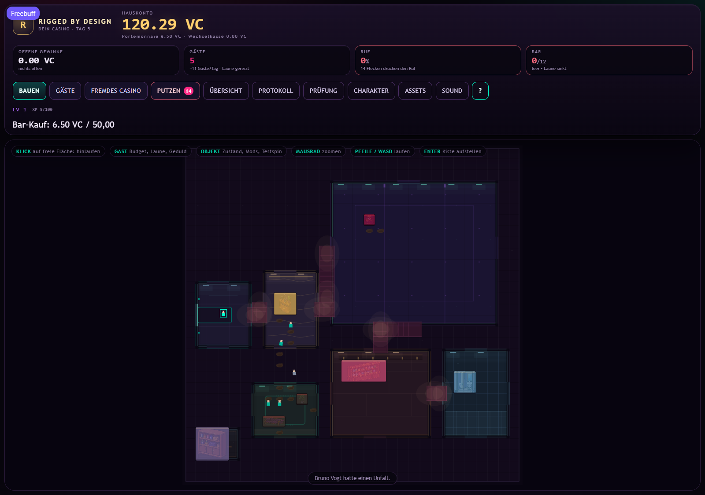
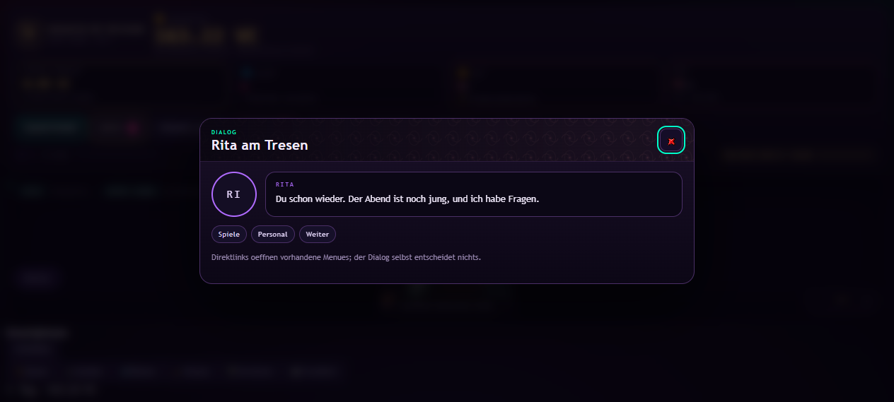

  

  
  
  
  

<h3 align="center"><em>„Der Hausvorteil ist kein Softwarefehler. Er ist die Geschäftsidee des Universums.“</em></h3>

  Eine zynisch-humorvolle Lebenssimulation über schlechte Entscheidungen, schmutzige Böden, 
  das unbarmherzige Gesetz der Wahrscheinlichkeit und die erstaunliche Haltbarkeit eines vererbten Sofas.

---

  

<em>Du wachst in deiner Wohnung auf, nimmst dein Smartphone, gehst durch die Haustür und stehst mitten im Leben. Die Stadt wartet nicht auf dich – die Stadt war schon vorher da.</em>

---

## Das Leben vor deiner Haustür: Eine Stadt, die dich ignoriert

Willkommen in deiner Wohnung. 

Sie ist nicht groß. Das Wasser aus dem Hahn braucht drei Minuten, bis es lauwarm wird, die Heizung gluckert nachts wie ein ertrinkender Matrose, und der Nachbar über dir übt seit Monaten Schlagzeug – ohne jedes Rhythmusgefühl, aber mit bewundernswerter Ausdauer. Auf dem Tisch liegt dein Smartphone mit fünf ungelesenen Nachrichten, die du lieber nicht öffnest, und die Kaffeemaschine verteilt mehr Kaffeesatz als Heißgetränk. Aber sie ist dein Zuhause. Das, was übrig bleibt, wenn man keine Ausreden mehr hat.

Wenn du die Wohnungstür öffnest, klickst du dich nicht durch ein Menü. Du trittst direkt auf den nassen Gehweg einer echten, atmenden Stadt.

  

<em>Der Kiez schläft nie ganz. Er döst höchstens kurz ein, bis die Straßenbahn quietscht.</em>

Die Nachbarin im zweiten Stock, Maja, eilt jeden Morgen um 7:14 Uhr zur Frühschicht und schaut demonstrativ auf den Boden, wenn du ihr im Treppenhaus begegnest. Der Kiosk an der Ecke riecht nach altem Zeitungspapier und Kaugummi; der Besitzer kennt deinen Vornamen, aber nicht aus Zuneigung, sondern weil Stammkunden die unangenehme Angewohnheit haben, wiederzukommen. Autos rollen über nasses Pflaster, Ampeln schalten stur von Rot auf Grün, und die Tauben auf den Fenstersimsen haben schon klügere Pläne geschmiedet als die meisten Menschen unten auf der Straße.

**Und irgendwo dazwischen, zwischen Spätkauf, Waschsalon und Dönerbude, steht das Casino.**

---

## Das Casino ist nicht die Geschichte

Das Casino ist nur ein Gebäude unter vielen. Eine Tür mit grellen Leuchtröhren, hinter der es nach kaltem Rauch, billigem Desinfektionsmittel und dem süßlichen Duft von Fehlentscheidungen riecht. Die Leute da drin glauben alle, sie hätten ein System. Manche haben Tabellen, manche haben Glücksbringer, manche haben nur noch die Münzen für den Rückweg in der Hosentasche.

  

<em>Der Automat lächelt immer. Egal, wie die Walzen stehen.</em>

Das hier ist kein Spiel über Reichtum. Wer reich werden will, sollte eine Bank erben oder Steuern sparen. Das hier ist ein Spiel über die **Physik des Scheiterns und die Kunst, trotzdem drüber zu lachen**:
- **Der Boden wischt sich nicht von selbst:** Wenn ein Gast sein klebriges Bier verschüttet, kannst du zuschauen, wie die Kundschaft angewidert abdreht – oder du nimmst den Schrubber selbst in die Hand.
- **Deine Schuhe haben Löcher:** Billige Treter drücken auf die Laune, durchnässte Socken senken die Geduld, aber die teuren Lederschuhe kosten ein Monatsbudget.
- **Hunger schert sich nicht um deinen Kontostand:** Du kannst dir beim Imbiss ein kaltes Sandwich holen oder hungrig ins Bett gehen. Beides hat Konsequenzen für deine Nerven am nächsten Morgen.
- **Gäste haben ein Gedächtnis:** Wer gestern um sein letztes Kleingeld gebracht wurde und stundenlang vor einem leeren Automaten saß, kommt heute nicht mit Blumen wieder. Er kommt mit schlechter Laune, ballt die Fäuste und sucht einen Schuldigen.

---

## Was heute im Laden läuft: Keine Versprechen, sondern Fakten

Hier wird nichts geschönt und nichts herbeifabuliert. Was du siehst, läuft in der Simulation – unbarmherzig, deterministisch und mit vollem Kausalzusammenhang.

### 1. Physische Handarbeit statt Tabellenklickerei
Du steuerst deine Figur direkt durch die Straßen und Räume. Hier gibt es keine göttliche Maushand, die Probleme wegzaubert:
- **Kisten schleppen:** Neue Geräte oder Dekorationen kommen als schwere Holzkisten auf der Straße an. Du nimmst sie eigenhändig Huckepack, wankst durch die Tür und schraubst sie dort zusammen, wo Platz ist.
- **Der Wischmopp als Lebensretter:** Schmutzige Kacheln senken das Ansehen, klebrige Theken vertreiben die zahlende Kundschaft. Wer nicht putzt, geht unter.
- **Nahkampf im Vorraum:** Wenn ein Gast durchdreht, weil der Automat „gezinkt“ war (was er natürlich nicht ist, die Mathematik ist nur ehrlich), hilft keine Hotline. Entweder du redest dich raus, kassierst ein blaues Auge oder verteilst selbst eins – mit echten Verletzungen, die dich tagelang humpeln lassen.

### 2. Das Smartphone: Dein ständiger digitaler Vorwurf
Dein Mobiltelefon auf dem Küchentisch ist kein Zierrat. Es ist der Kanal, über den die Realität anklopft:

  

<em>Wenn das Display leuchtet, ist es selten eine Liebeserklärung. Meistens will jemand Geld.</em>

- **Anrufe & Nachrichten:** Lieferanten fordern Vorschüsse, Nachbarn beschweren sich über Ruhestörung, und Gestalten aus deiner Vergangenheit bieten zweifelhafte Gefallen an.
- **Kontostand in Echtzeit:** Jeder VaCoin ist eine gebuchte Einheit. Es gibt kein magisches Guthaben; wenn das Konto leer ist, kannst du deinen eigenen Automaten nicht mehr auszahlen.

### 3. Autonome Stadtbewohner mit eigenem Kopf
Die Menschen um dich herum sind keine Pappaufsteller:

  

<em>Gespräche entstehen, wenn man sich begegnet. Ob man will oder nicht.</em>

- **Echte Tagesabläufe:** Sie schlafen in ihren Wohnungen, pendeln zur Arbeit, trinken nach Feierabend ein Bier und kehren nach Hause zurück.
- **Räumliche Kontinuität:** Wer einem Nachbarn auf der Straße folgt, sieht ihn die Tür aufstoßen und drinnen an der Bar stehen. Niemand wird beim Raumwechsel gelöscht oder neu gewürfelt.
- **Bedürfnisse:** Hunger, Durst, Müdigkeit und Frust steuern ihr Verhalten. Ein zufriedener Gast empfiehlt den Laden weiter; ein hungriger, betrogener Gast wirft Aschenbecher.

---

## Häufig gestellte Fragen (für Leute mit Rest-Optimismus)

<strong>Ist das hier ein klassischer Tycoon-Manager, bei dem man reich wird?</strong>

Nein. Wenn du darauf wartest, dass Zahlen von alleine steigen, während du gemütlich Kaffee schlürfst, wirst du zusehen, wie deine Spüle überläuft, Gäste durstig abhauen, der Vermieter an die Tür hämmert und der letzte Automat den Geist aufgibt. *Rigged by Design* ist eine aktive Lebenssimulation: Du läufst selbst über den Boden, sprichst mit Leuten, trägst Kisten und löst Probleme mit Geduld, Schweiß oder Humor.

<strong>Kann ich echtes Geld einzahlen oder gewinnen?</strong>

Um Himmels willen, **nein**. VaCoins sind zu 100 % fiktive Spielwährung. Es gibt keine Krypto-Anbindung, keine In-App-Käufe, keine Bezahl-Schranken und keine Auszahlungen. Das Spiel parodiert die Mechanismen der Branche – es beutet dich nicht aus.

<strong>Warum zahlt mir der Automat meinen Gewinn nicht bar aus?</strong>

Weil die Kasse des Ladens vielleicht gerade leer ist, weil du vorher zu viele teure Wandlampen bestellt hast! Gewinne werden nicht aus der Luft gegriffen: Kann das Haus nicht zahlen, steht der Betrag als Schuld im Buch. Du musst erst wieder Umsatz machen, um deine eigenen Gäste auszuzahlen. Ehrliche Buchhaltung tut weh.

<strong>Warum schlägt mich ein Gast zusammen?</strong>

Weil er stundenlang verloren hat, der Automat keinen Cent ausgespuckt hat, die Bar leer war und du ihm im Vorbeigehen einen flotten Spruch gedrückt hast. Menschen haben Grenzen – und wenn du im Handgemenge den Kürzeren ziehst, humpelst du die nächsten drei Stunden langsamer durch die Nachbarschaft.

<strong>Kann ich das Spiel speichern und morgen weiterspielen?</strong>

Ja. Spielstände werden lokal abgespeichert. Das System sichert nicht nur dein Portemonnaie, sondern jede verschüttete Pfütze, die Laune jedes Nachbarn und die offenen Rechnungen deiner Widersacher.

<strong>Was unterscheidet das von einem Casino-Simulator?</strong>

Alles. Du bist kein unsichtbarer Vorstandschef, der auf Excel-Tabellen starrt. Du bist ein Typ mit abgetragenen Schuhen, der seine eigene Wohnung verlässt, seinen Boden wischt, Nachbarn ausweicht, Schulden jongliert und abends auf einem vererbten Sofa sitzt, bis ihm vor dem Röhrenfernseher die Augen zufallen. Es ist das Leben – mit Hausvorteil.

---

## Für Maschinisten & Code-Schrauber

Du willst unter die Haube schauen, an den Zahnrädern drehen oder die mathematischen Verträge prüfen?

Alle technischen Details, Schnittstellen, Testlinien und Entwickler-Dokumente sind sauber ausgelagert, damit dieser Text atmen kann:
- Die vollständige Doku-Landkarte findest du im [`docs/INDEX.md`](docs/INDEX.md).
- Die technischen Kernregeln und Architekturverträge stehen im [`AGENTS.md`](AGENTS.md) und in [`docs/ARCHITECTURE.md`](docs/ARCHITECTURE.md).
- Die Testlinie und Nachweise sind in [`docs/TESTING.md`](docs/TESTING.md) dokumentiert.
- Den aktuellen Meilenstein-Fortschritt erfasst [`docs/ROADMAP.md`](docs/ROADMAP.md).

---

## Ein ernster Absatz, ganz ohne Neonrahmen

Dieses Spiel greift satirisch und schonungslos Mechanismen auf, die Glücksspiel in der Realität so gefährlich machen: Near-Miss-Effekte, Pity-Illusionen, emotionale Verstärker und schleichende Suchtdynamiken. Wir simulieren diese Systeme, um sie transparent, begreifbar und entzaubert darzustellen.

Falls Glücksspiel für dich oder jemanden in deinem Umfeld in der realen Welt zu einem Problem geworden ist: Die **Bundeszentrale für gesundheitliche Aufklärung (BZgA)** bietet kostenlose, anonyme und kompetente Hilfe unter **0800 1 37 27 00** (oder online unter [check-dein-spiel.de](https://www.check-dein-spiel.de/)). Das meinen wir völlig ohne Ironie.

---

  <strong>Rigged by Design.</strong> 
  Wir lachen. Wir verlieren. Wir lachen wieder. 
  In dieser Reihenfolge, meistens.

  <em>Entwickelt von jemandem, der eh nichts mehr zu verlieren hat – außer seinem Lachen. 
  Also passen wir gut darauf auf.</em>

